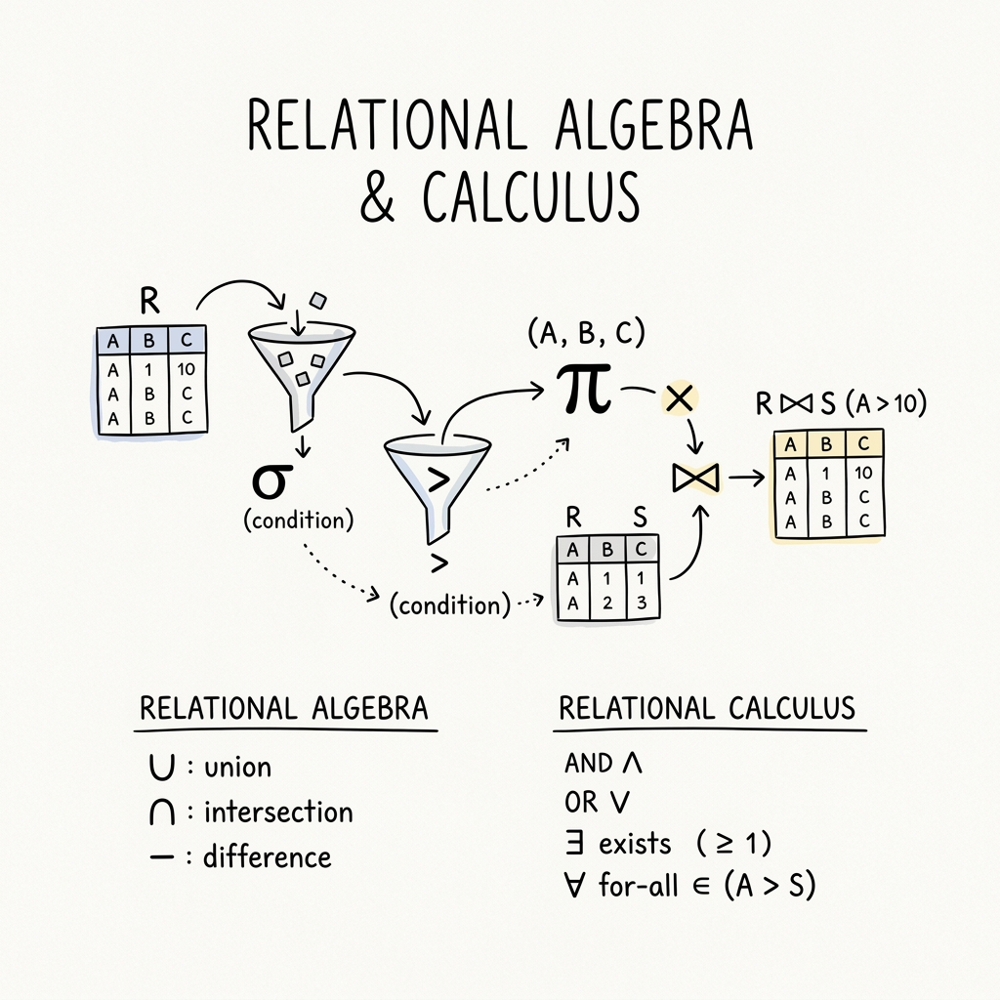
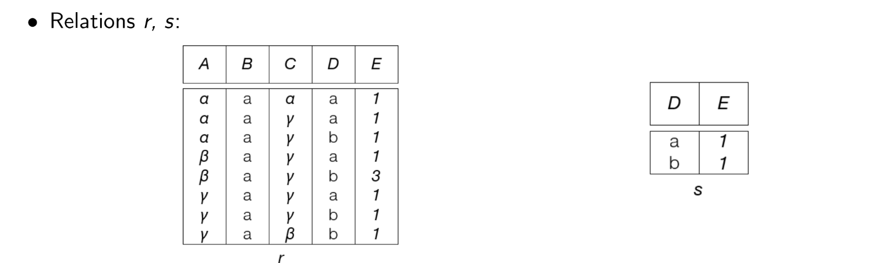

## Learning Objectives

After this chapter, students should be able to:

- distinguish procedural Relational Algebra from declarative TRC and DRC;
- evaluate selection, projection, joins, set operations, and division;
- translate common SQL filters and projections into RA, TRC, and DRC, and explain their limits around `NULL`, aggregation, duplicates, and ordering.

# Introduction to Query Languages

Query languages in DBMS are broadly classified into two categories:

1. **Procedural Query Languages**: The user specifies *what* data is needed and *how* to get it. Relational Algebra is a procedural language.
2. **Non-Procedural (Declarative) Query Languages**: The user specifies *what* data is needed without specifying *how* to get it. Relational Calculus is a non-procedural language.

---

## Relational Foundations and Notation

Relational Algebra and Relational Calculus are built on the **relational model**. These terms are used throughout the chapter:

| Term | Definition | Example |
|---|---|---|
| **Relation schema** | The relation name and its attributes (and, in a database, their domains). | `Student(RollNo, Name, Age, Subject)` |
| **Relation instance** | The set of tuples currently stored for a schema. | The current set of `Student` records. |
| **Tuple** | One ordered assignment of values to the attributes of a relation. | `(26f10, Alice, 21, DBMS)` |
| **Attribute** | A named component of a relation. | `Name` in `Student`. |
| **Domain** | The allowed set of values for an attribute. | `Age` may use nonnegative integers. |
| **Degree** | The number of attributes in a relation schema. | `Student` above has degree 4. |
| **Cardinality** | The number of tuples in a particular relation instance. | A `Student` instance with 30 rows has cardinality 30. |

Classical relations are sets: they have no duplicate tuples and no meaningful row order. SQL tables/results often behave like **bags** (multisets) unless `DISTINCT` is specified, and SQL does not guarantee result order unless `ORDER BY` is used. SQL also includes `NULL` and aggregates, which require extensions beyond the simplest classical relational model.

# Relational Algebra (RA)

Relational Algebra (RA) is a **procedural query language**: each operator takes one or more relations as input and returns a relation. This closure property lets operators be composed into larger expressions. Under classical set semantics, a relation is an unordered set of distinct tuples.

The six primitive operators commonly used to define the core algebra are:

| Operator | Meaning | Example form |
|---|---|---|
| **Selection** ($\sigma$) | Keeps rows that satisfy a predicate; the schema is unchanged. | $\sigma_{Age>25}(Students)$ |
| **Projection** ($\pi$) | Keeps the listed attributes; duplicate result tuples are removed. | $\pi_{Name,Age}(Students)$ |
| **Union** ($\cup$) | Returns tuples that occur in either input relation. | $R\cup S$ |
| **Set difference** ($-$) | Returns tuples in the first relation that are not in the second. | $R-S$ |
| **Cartesian product** ($\times$) | Pairs every tuple in the first relation with every tuple in the second. | $R\times S$ |
| **Rename** ($\rho$) | Renames a relation and/or its attributes. | $\rho_{S(A,B)}(R)$ |

Union and set difference require **union-compatible** inputs: the relations must have the same number of attributes and corresponding attributes must have compatible domains. Projection may remove duplicates because RA uses sets; SQL keeps duplicates by default unless `DISTINCT` is specified.

**Important distinction:** $\neg$ is a logical connective used in predicates, not a standalone primitive relational-algebra operator. Intersection, joins, and division are useful derived operators; they can be expressed using the primitive operators (division may require a longer expression). Some textbooks call a different but equivalent set of operators “primitive.”

### Common Derived Operators

- **Intersection** ($R\cap S$): tuples in both relations. It can be defined as $R-(R-S)$ and requires union-compatible inputs.
- **Theta join** ($R\bowtie_{\theta}S$): first forms $R\times S$, then keeps pairs satisfying condition $\theta$. In symbols, $R\bowtie_{\theta}S=\sigma_{\theta}(R\times S)$.
- **Equijoin**: a theta join whose condition uses equality comparisons.
- **Natural join** ($R\bowtie S$): matches on every same-named attribute and includes each shared attribute only once in the result. Check attribute names carefully; an unintended shared name changes the join condition.
- **Division** ($R\div S$): finds values related to **every** tuple in $S$; see the division example below.

For example, when `Students(RollNo, Name, Age)` and `Activity(RollNo, Sports, Awards)` share the key `RollNo`, their natural join matches each student with their activity records. If unrelated relations share a column name, rename an attribute or use an explicit theta join instead.

## Examples

**1. Find all the names of students whose age is greater than 25, or who are enrolled in Maths**

Schema:
- `Students(RollNo, Name, Age, Subject)`

First, we filter the `Students` table using the Selection ($\sigma$) operation for the condition `Age > 25 OR Subject = 'Maths'`. Then, we use the Projection ($\pi$) operation to only retrieve the `Name` attribute.

$$ \pi_{Name}(\sigma_{Age>25 \space \lor \space Subject='Maths'}(Students)) $$


**2. Find the name and sports of the student whose age is less than 25 and awards is greater than 3**

Schema:
- `Students(RollNo, Name, Age)`
- `Activity(RollNo, Sports, Awards)`

Here we need data from two different domains (the `Students` and `Activity` tables). We use a Natural Join ($⋈$) to combine them on their common attribute (`RollNo`), filter the result, and project the specific columns.

$$ \pi_{Name, Sports}(\sigma_{Age<25 \space \land \space Awards>3}(Students ⋈ Activity)) $$

## Division Operation

The **Division ($r \div s$)** operation is used in queries that involve the word "every" or "all". For example, "Find students who have taken *all* courses offered in the Biology department."

Suppose we have two relations: $r(A, B, C)$ and $s(B, C)$. The result of $r \div s$ will be a relation with the attribute $A$, containing values of $A$ that match with *all* the tuples present in $s$.

{width=80%}

In the mathematical example from the notes, if we perform $r \div s$:

|A|B|C|
|-|-|-|
|$\alpha$|a|$\gamma$|
|$\gamma$|a|$\gamma$|

The output would be the values in column `A` ($\alpha$ and $\gamma$) that are associated with all tuples of the divisor.

---

# Tuple Relational Calculus (TRC)

TRC is **declarative**: it describes which tuples belong in the answer rather than a sequence of operations to retrieve them. A query has the form:

$$
\{t \mid P(t)\}
$$

Here, $t$ is an output tuple and $P(t)$ is a predicate that must be true. Tuple variables represent whole rows; write $s[grade]$ to refer to one attribute of tuple $s$. Predicates use $\land$ (and), $\lor$ (or), and $\neg$ (not), together with $\exists$ (there exists) and $\forall$ (for every).

# Domain Relational Calculus (DRC)

DRC is also **declarative** and has the same expressive power as TRC for safe queries. Its variables represent individual attribute values rather than whole rows. A query has the form:

$$
\{\langle x_1,\ldots,x_n\rangle \mid P(x_1,\ldots,x_n)\}
$$

The ordered values in $\langle x_1,\ldots,x_n\rangle$ form each output row. In a relation-membership atom, list values in the exact order of that relation's schema. Output variables must be restricted to values from the relations, constants, or other bounded predicates in the query; this safety condition prevents an unbounded answer.

### How RA and Calculus Relate

Relational Algebra specifies operations; relational calculus specifies predicates that the result must satisfy. **Codd's theorem** states that relational algebra and the safe (range-restricted) relational calculus have the same expressive power: each query in one can be expressed in the other. This does not mean they use the same notation, nor that basic RA/calculus directly expresses every SQL feature. Aggregation, ordering, and SQL's `NULL` behavior are examples that require extensions or additional semantics.

## Translating Between SQL, RA, TRC, and DRC

Use one schema throughout the examples:

`student(roll_no, name, level, course, term, grade)`

In DRC, we will use $r,n,l,c,tm,g$ for those six attributes, in order. SQL uses bag semantics by default, so examples use `DISTINCT` when needed to match the set semantics of classical RA and calculus.

### A Three-Part Recipe

1. **Target:** Identify the output columns. They go in SQL's `SELECT`, RA's projection ($\pi$), the output tuple in TRC, and the free variables inside DRC's angle brackets.
2. **Source:** Identify the relation(s). They go in SQL's `FROM`, the input to RA, and relation-membership conditions in TRC/DRC.
3. **Conditions:** Translate filters into SQL's `WHERE`, RA's selection ($\sigma$), and logical predicates in TRC/DRC.

For SQL-to-calculus translation, work in the same order: assign one variable to each source attribute, copy the `WHERE` condition as a predicate, return the requested variables, and existentially quantify the remaining variables. To translate back, the output variables become `SELECT`, the relation-membership atom becomes `FROM`, and the remaining predicate becomes `WHERE`.

### Example 1: Filter Rows and Return a Name

**Request:** Find the names of students enrolled in `DBMS` who received an `A`.

| Language | Query |
|---|---|
| SQL | `SELECT DISTINCT name FROM student WHERE course = 'DBMS' AND grade = 'A';` |
| RA | $\pi_{name}(\sigma_{course='DBMS'\land grade='A'}(student))$ |
| TRC | $\{t \mid \exists s\in student\ (t[name]=s[name]\land s[course]='DBMS'\land s[grade]='A')\}$ |
| DRC | $\{\langle n\rangle \mid \exists r,l,c,tm,g\ (\langle r,n,l,c,tm,g\rangle\in student\land c='DBMS'\land g='A')\}$ |

RA reads from the inside out: select qualifying rows first, then project `name`. TRC's $s$ is a whole source row; $t$ is a one-column output tuple. DRC returns $n$ and quantifies the other five attribute values.

### Example 2: Combine Conditions with `AND`

**Request:** Find the roll numbers and names of Degree students enrolled in `DBMS` during `27t1`.

| Language | Query |
|---|---|
| SQL | `SELECT DISTINCT roll_no, name FROM student WHERE level = 'Degree' AND course = 'DBMS' AND term = '27t1';` |
| RA | $\pi_{roll\_no,name}(\sigma_{level='Degree'\land course='DBMS'\land term='27t1'}(student))$ |
| TRC | $\{t \mid \exists s\in student\ (t[roll\_no]=s[roll\_no]\land t[name]=s[name]\land s[level]='Degree'\land s[course]='DBMS'\land s[term]='27t1')\}$ |
| DRC | $\{\langle r,n\rangle \mid \exists l,c,tm,g\ (\langle r,n,l,c,tm,g\rangle\in student\land l='Degree'\land c='DBMS'\land tm='27t1')\}$ |

Every condition must hold, so conjunction ($\land$) corresponds to SQL `AND` and a combined selection predicate in RA.

**Translation walkthrough:** `roll_no` and `name` are the requested output, so they appear in the projection and result tuple. The source is one `student` row. The three tests are joined with `AND`; in DRC, assign variables in schema order and leave only $r,n$ free in the answer.

### Example 3: Alternatives with `OR` / `IN`

**Request:** Find the names of DBMS students who received either an `A` or an `S`.

| Language | Query |
|---|---|
| SQL | `SELECT DISTINCT name FROM student WHERE course = 'DBMS' AND grade IN ('A', 'S');` |
| RA | $\pi_{name}(\sigma_{course='DBMS'\land(grade='A'\lor grade='S')}(student))$ |
| TRC | $\{t \mid \exists s\in student\ (t[name]=s[name]\land s[course]='DBMS'\land(s[grade]='A'\lor s[grade]='S'))\}$ |
| DRC | $\{\langle n\rangle \mid \exists r,l,c,tm,g\ (\langle r,n,l,c,tm,g\rangle\in student\land c='DBMS'\land(g='A'\lor g='S'))\}$ |

Parentheses make the intended logic clear: the course must be DBMS, and the grade may be either A or S. `IN` is SQL shorthand for alternatives joined by `OR`.

**Translation walkthrough:** First require the course test, then group the two acceptable grades together. The intended predicate is `course = 'DBMS' AND (grade = 'A' OR grade = 'S')`; parentheses prevent an A or S from another course from qualifying.

### Example 4: Translate SQL into DRC, Then Back

Start with:

```sql
SELECT DISTINCT roll_no, course
FROM student
WHERE level = 'Degree';
```

The output attributes are `roll_no` and `course`, assigned $r$ and $c$. The relation tuple is $\langle r,n,l,c,tm,g\rangle$ in schema order. The condition is $l='Degree'$, and the remaining variables are existentially quantified:

$$
\{\langle r,c\rangle \mid \exists n,l,tm,g\ (\langle r,n,l,c,tm,g\rangle\in student\land l='Degree')\}
$$

To translate this DRC expression back to SQL, select the free variables `r` and `c` as `roll_no` and `course`, use `student` as the source, and translate the remaining predicate to `WHERE level = 'Degree'`.

**Reverse-translation checklist:** The free variables become the `SELECT` list. The tuple-membership condition supplies the `FROM` table and its attribute order. The predicate on $l$ becomes the `WHERE` filter. Quantified variables describe a matching row but do not appear in the output columns.

### Example 5: Find Students in Both Courses

**Request:** Find roll numbers and names of students with an enrollment in both `DBMS` and `Math`.

| Language | Query |
|---|---|
| SQL | `SELECT DISTINCT d.roll_no, d.name FROM student AS d WHERE EXISTS (SELECT 1 FROM student AS m WHERE m.roll_no = d.roll_no AND m.course = 'Math') AND d.course = 'DBMS';` |
| RA | $\pi_{roll\_no,name}(\sigma_{course='DBMS'}(student))\cap\pi_{roll\_no,name}(\sigma_{course='Math'}(student))$ |
| TRC | $\{t \mid \exists d\in student\ (t[roll\_no]=d[roll\_no]\land t[name]=d[name]\land d[course]='DBMS'\land\exists m\in student\ (m[roll\_no]=d[roll\_no]\land m[course]='Math'))\}$ |
| DRC | $\{\langle r,n\rangle \mid \exists l_1,tm_1,g_1,l_2,tm_2,g_2\ (\langle r,n,l_1,'DBMS',tm_1,g_1\rangle\in student\land\langle r,n,l_2,'Math',tm_2,g_2\rangle\in student)\}$ |

This is set intersection: the same `(roll_no, name)` pair must appear in both course results. The two enrollments may be in different terms; add matching `term` conditions if the question requires the courses in the same term.

**Why the SQL subquery is correlated:** The inner query uses `m.roll_no = d.roll_no`, so it tests Math enrollments for the particular student currently being considered by the outer query. In DRC, the same free variables $r,n$ occur in both relation tuples, forcing both facts to refer to the same student.

### Example 6: Find Students in One Course but Not Another

**Request:** Find roll numbers and names of DBMS students who are not enrolled in Math.

| Language | Query |
|---|---|
| SQL | `SELECT DISTINCT d.roll_no, d.name FROM student AS d WHERE d.course = 'DBMS' AND NOT EXISTS (SELECT 1 FROM student AS m WHERE m.roll_no = d.roll_no AND m.course = 'Math');` |
| RA | $\pi_{roll\_no,name}(\sigma_{course='DBMS'}(student))-\pi_{roll\_no,name}(\sigma_{course='Math'}(student))$ |
| TRC | $\{t \mid \exists d\in student\ (t[roll\_no]=d[roll\_no]\land t[name]=d[name]\land d[course]='DBMS'\land\neg\exists m\in student\ (m[roll\_no]=d[roll\_no]\land m[course]='Math'))\}$ |
| DRC | $\{\langle r,n\rangle \mid (\exists l,c,tm,g\ (\langle r,n,l,c,tm,g\rangle\in student\land c='DBMS'))\land\neg\exists l_2,tm_2,g_2\ (\langle r,n,l_2,'Math',tm_2,g_2\rangle\in student)\}$ |

The SQL `NOT EXISTS`, calculus negation, and RA difference all express absence of a matching Math enrollment.

**Watch the scope of “not”:** First require a DBMS row. Then, for that same roll number, require that no Math row exists. Negating the entire first condition would ask a different question: it would return students not enrolled in DBMS.

### Example 7: No A-Grade Enrollment

**Request:** Find students who have no enrollment record with grade `A`.

| Language | Query |
|---|---|
| SQL | `SELECT DISTINCT s.roll_no, s.name FROM student AS s WHERE NOT EXISTS (SELECT 1 FROM student AS a WHERE a.roll_no = s.roll_no AND a.grade = 'A');` |
| RA | $\pi_{roll\_no,name}(student)-\pi_{roll\_no,name}(\sigma_{grade='A'}(student))$ |
| TRC | $\{t \mid \exists s\in student\ (t[roll\_no]=s[roll\_no]\land t[name]=s[name]\land\neg\exists a\in student\ (a[roll\_no]=s[roll\_no]\land a[grade]='A'))\}$ |
| DRC | $\{\langle r,n\rangle \mid (\exists l,c,tm,g\ (\langle r,n,l,c,tm,g\rangle\in student))\land\neg\exists l_2,c_2,tm_2\ (\langle r,n,l_2,c_2,tm_2,'A'\rangle\in student)\}$ |

Notice the matching condition: this excludes a student if **any** of their rows has an A, in any course or term. The columns inside `NOT EXISTS` determine what “matching” means.

**Compare with Example 6:** That query excluded one particular course; this query excludes a grade across all courses. The SQL subquery and negated calculus predicate match on `roll_no` only, so changing the correlation columns changes which rows count as a match.

### Example 8: Find Students Taking Every Required Course

This query uses an additional relation `required_course(course)`, listing courses that every student must take.

**Request:** Find roll numbers and names of students enrolled in every required course.

| Language | Query |
|---|---|
| SQL | `SELECT DISTINCT s.roll_no, s.name FROM student AS s WHERE NOT EXISTS (SELECT 1 FROM required_course AS r WHERE NOT EXISTS (SELECT 1 FROM student AS e WHERE e.roll_no = s.roll_no AND e.course = r.course));` |
| RA | $\pi_{roll\_no,name}(student\bowtie(\pi_{roll\_no,course}(student)\div required\_course))$ |
| TRC | $\{t \mid \exists s\in student\ (t[roll\_no]=s[roll\_no]\land t[name]=s[name]\land\forall q\in required\_course\ \exists e\in student\ (e[roll\_no]=s[roll\_no]\land e[course]=q[course]))\}$ |
| DRC | $\{\langle r,n\rangle \mid (\exists l,c,tm,g\ (\langle r,n,l,c,tm,g\rangle\in student))\land\forall q\ (\langle q\rangle\in required\_course\rightarrow\exists l_2,tm_2,g_2\ (\langle r,n,l_2,q,tm_2,g_2\rangle\in student))\}$ |

The word **every** signals universal quantification ($\forall$) or relational division ($\div$). SQL expresses this as “there is no required course for which no enrollment exists,” hence the nested `NOT EXISTS` checks.

**Unpack the nested SQL:** The innermost query looks for an enrollment matching one required course. The middle query searches for a required course with no such enrollment. The outer `NOT EXISTS` accepts the student only if that search finds nothing. This is equivalent to saying that for **every** required course, a matching enrollment exists.

### Example 9: Inequality and the SQL `NULL` Boundary

**Request:** Find DBMS enrollments whose grade is not `C`.

| Language | Query |
|---|---|
| SQL | `SELECT DISTINCT roll_no, name FROM student WHERE course = 'DBMS' AND grade <> 'C';` |
| RA | $\pi_{roll\_no,name}(\sigma_{course='DBMS'\land grade\ne 'C'}(student))$ |
| TRC | $\{t \mid \exists s\in student\ (t[roll\_no]=s[roll\_no]\land t[name]=s[name]\land s[course]='DBMS'\land s[grade]\ne 'C')\}$ |
| DRC | $\{\langle r,n\rangle \mid \exists l,c,tm,g\ (\langle r,n,l,c,tm,g\rangle\in student\land c='DBMS'\land g\ne 'C')\}$ |

Classical RA, TRC, and DRC use two-valued logic and assume compared values are present. SQL `NULL` comparisons evaluate to `UNKNOWN`, so a row with a missing grade does not pass `grade <> 'C'`. Include missing grades with `OR grade IS NULL` in SQL; modeling this behavior requires extending the classical model.

### Example 10: Count Enrollments per Course

**Request:** Count the enrollment records for each course.

```sql
SELECT course, COUNT(*) AS enrollment_count
FROM student
GROUP BY course;
```

Classical RA/TRC/DRC do not directly express aggregation such as `COUNT`; extended relational algebra adds grouping/aggregate operators. This query counts enrollment rows, not distinct students. For distinct students, use `COUNT(DISTINCT roll_no)`.

`GROUP BY course` forms one group per course, and `COUNT(*)` counts the rows in each group. The result has one output row per course, rather than one output row per enrollment.

### Example 11: Sort Course Names

**Request:** List distinct course names in alphabetical order.

```sql
SELECT DISTINCT course
FROM student
ORDER BY course;
```

RA and the calculi describe unordered sets. They can express which course names are in the answer, but not their display order. `ORDER BY` is a SQL presentation feature.

`DISTINCT` removes repeated course names before presentation, while `ORDER BY course` sorts the remaining values. Without `ORDER BY`, SQL does not promise alphabetical output; without `DISTINCT`, a course may appear once for each enrollment.

### Summary: Translate the Core Pieces

| Meaning | SQL | RA | TRC / DRC |
|---|---|---|---|
| Choose source rows | `FROM` | Relation input | Relation membership (`s in student`, tuple in relation) |
| Filter rows | `WHERE` | $\sigma$ | Predicate after `\mid` |
| Choose output attributes | `SELECT` | $\pi$ | Output tuple / free variables |
| “and” / “or” / “not” | `AND` / `OR` / `NOT` | $\land$ / $\lor$ / difference | $\land$ / $\lor$ / $\neg$ |
| “some” / “every” | `EXISTS` / `NOT EXISTS` patterns | Division for “every” | $\exists$ / $\forall$ |

## Practice: Translate in Both Directions

For each request, write SQL, RA, TRC, and DRC. In calculus, identify the output variables and the quantified variables.

1. Find the names of `Math` students who received a `B` or `C` during `27t1`.
2. Find students enrolled in both `DBMS` and `Physics`.
3. Express “every required course” using $\forall$, then rewrite its meaning in plain English.

**Check your reasoning:** Exercise 1 combines `course = 'Math'`, `term = '27t1'`, and `(grade = 'B' OR grade = 'C')`. Exercise 2 uses intersection or two matching-existence predicates. Exercise 3 uses universal quantification; “at least one required course” instead uses $\exists$.

## Chapter Review

1. A relation has 5 attributes and 12 tuples. What are its degree and cardinality?
2. Why must the inputs to `UNION` be union-compatible?
3. In a natural join, what happens if two relations share an attribute name that was not intended as a join key?
4. In a DRC query over `student(roll_no, name, level, course, term, grade)`, why must the tuple-membership values follow that order?
5. Which phrase in a query should prompt you to consider division or universal quantification?
6. Why can `SELECT` return duplicates when the equivalent classical RA query does not?

**Quick check:** The answers are, respectively: degree 5 and cardinality 12; same number of attributes with compatible corresponding domains; the join also matches on that attribute; relation membership is positional and must follow the schema; “every” or “all”; SQL uses bag semantics unless `DISTINCT` is specified.
