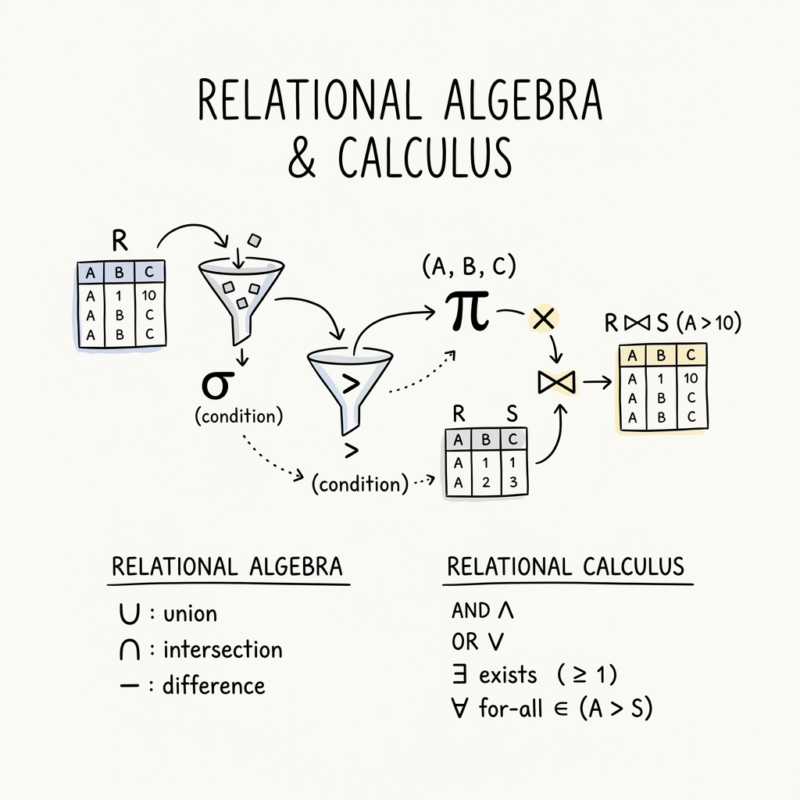

# Introduction to Query Languages

Query languages in DBMS are broadly classified into two categories:

1. **Procedural Query Languages**: The user specifies *what* data is needed and *how* to get it. Relational Algebra is a procedural language.
2. **Non-Procedural (Declarative) Query Languages**: The user specifies *what* data is needed without specifying *how* to get it. Relational Calculus is a non-procedural language.

---

## Relational Foundations and Notation

Relational Algebra and Relational Calculus are built on the **relational model**. These terms are used throughout the chapter:

| Term | Definition | Example |
|---|---|---|
| **Relation schema** | The relation name and its attributes (and, in a database, their domains). | `Student(RollNo, Name, Age, Subject)` |
| **Relation instance** | The set of tuples currently stored for a schema. | The current set of `Student` records. |
| **Tuple** | One ordered assignment of values to the attributes of a relation. | `(26f10, Alice, 21, DBMS)` |
| **Attribute** | A named component of a relation. | `Name` in `Student`. |
| **Domain** | The allowed set of values for an attribute. | `Age` may use nonnegative integers. |
| **Degree** | The number of attributes in a relation schema. | `Student` above has degree 4. |
| **Cardinality** | The number of tuples in a particular relation instance. | A `Student` instance with 30 rows has cardinality 30. |

Classical relations are sets: they have no duplicate tuples and no meaningful row order. SQL tables/results often behave like **bags** (multisets) unless `DISTINCT` is specified, and SQL does not guarantee result order unless `ORDER BY` is used. SQL also includes `NULL` and aggregates, which require extensions beyond the simplest classical relational model.

# Relational Algebra (RA)

Relational Algebra (RA) is a **procedural query language**: each operator takes one or more relations as input and returns a relation. This closure property lets operators be composed into larger expressions. Under classical set semantics, a relation is an unordered set of distinct tuples.

The six primitive operators commonly used to define the core algebra are:

| Operator | Meaning | Example form |
|---|---|---|
| **Selection** ($\sigma$) | Keeps rows that satisfy a predicate; the schema is unchanged. | $\sigma_{Age>25}(Students)$ |
| **Projection** ($\pi$) | Keeps the listed attributes; duplicate result tuples are removed. | $\pi_{Name,Age}(Students)$ |
| **Union** ($\cup$) | Returns tuples that occur in either input relation. | $R\cup S$ |
| **Set difference** ($-$) | Returns tuples in the first relation that are not in the second. | $R-S$ |
| **Cartesian product** ($\times$) | Pairs every tuple in the first relation with every tuple in the second. | $R\times S$ |
| **Rename** ($\rho$) | Renames a relation and/or its attributes. | $\rho_{S(A,B)}(R)$ |

Union and set difference require **union-compatible** inputs: the relations must have the same number of attributes and corresponding attributes must have compatible domains. Projection may remove duplicates because RA uses sets; SQL keeps duplicates by default unless `DISTINCT` is specified.

**Important distinction:** $\neg$ is a logical connective used in predicates, not a standalone primitive relational-algebra operator. Intersection, joins, and division are useful derived operators; they can be expressed using the primitive operators (division may require a longer expression). Some textbooks call a different but equivalent set of operators “primitive.”

### Common Derived Operators

- **Intersection** ($R\cap S$): tuples in both relations. It can be defined as $R-(R-S)$ and requires union-compatible inputs.
- **Theta join** ($R\bowtie_{\theta}S$): first forms $R\times S$, then keeps pairs satisfying condition $\theta$. In symbols, $R\bowtie_{\theta}S=\sigma_{\theta}(R\times S)$.
- **Equijoin**: a theta join whose condition uses equality comparisons.
- **Natural join** ($R\bowtie S$): matches on every same-named attribute and includes each shared attribute only once in the result. Check attribute names carefully; an unintended shared name changes the join condition.
- **Division** ($R\div S$): finds values related to **every** tuple in $S$; see the worked examples.

See [worked RA examples](02_relational_algebra_examples.qmd) for joins, division, and SQL translations.

---

# Tuple Relational Calculus (TRC)

TRC is **declarative**: it describes which tuples belong in the answer rather than a sequence of operations to retrieve them. A query has the form:

$$
\{t \mid P(t)\}
$$

Here, $t$ is an output tuple and $P(t)$ is a predicate that must be true. Tuple variables represent whole rows; write $s[grade]$ to refer to one attribute of tuple $s$. Predicates use $\land$ (and), $\lor$ (or), and $\neg$ (not), together with $\exists$ (there exists) and $\forall$ (for every).

# Domain Relational Calculus (DRC)

DRC is also **declarative** and has the same expressive power as TRC for safe queries. Its variables represent individual attribute values rather than whole rows. A query has the form:

$$
\{\langle x_1,\ldots,x_n\rangle \mid P(x_1,\ldots,x_n)\}
$$

The ordered values in $\langle x_1,\ldots,x_n\rangle$ form each output row. In a relation-membership atom, list values in the exact order of that relation's schema. Output variables must be restricted to values from the relations, constants, or other bounded predicates in the query; this safety condition prevents an unbounded answer.

## How RA and Calculus Relate

Relational Algebra specifies operations; relational calculus specifies predicates that the result must satisfy. **Codd's theorem** states that RA and safe (range-restricted) relational calculus have the same expressive power. Basic RA and calculus do not directly express every SQL feature, such as aggregation, ordering, or SQL's `NULL` behavior.

Worked examples for RA, TRC, and DRC are on the [examples page](02_relational_algebra_examples.qmd).
