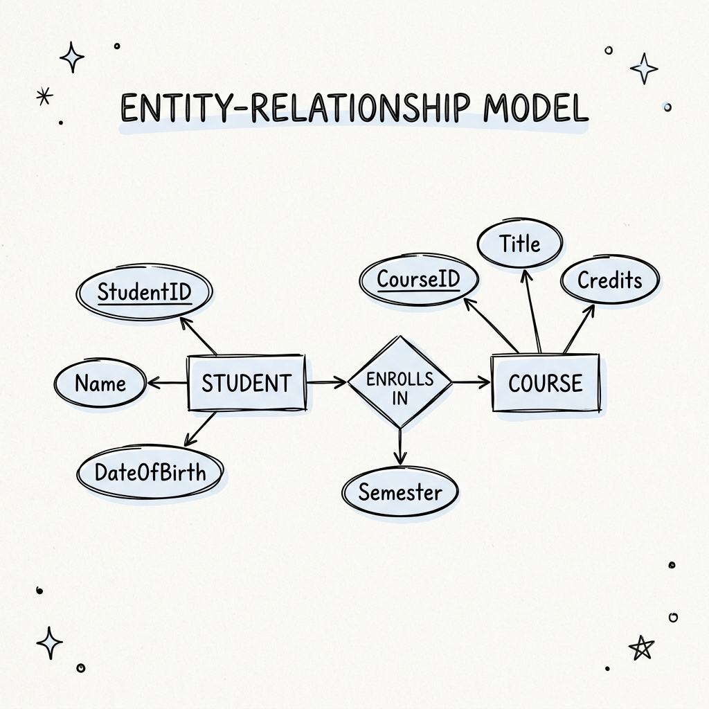
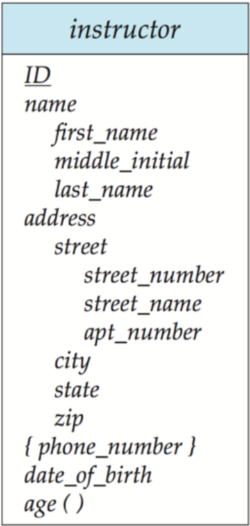
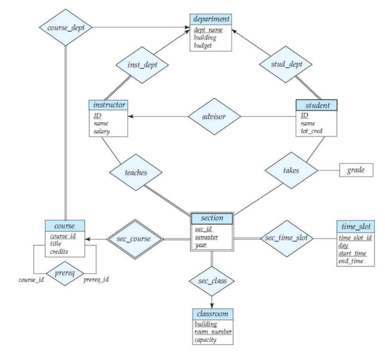
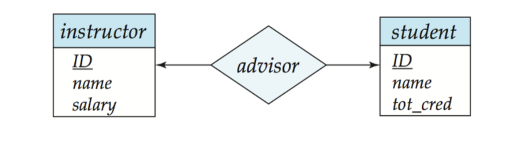
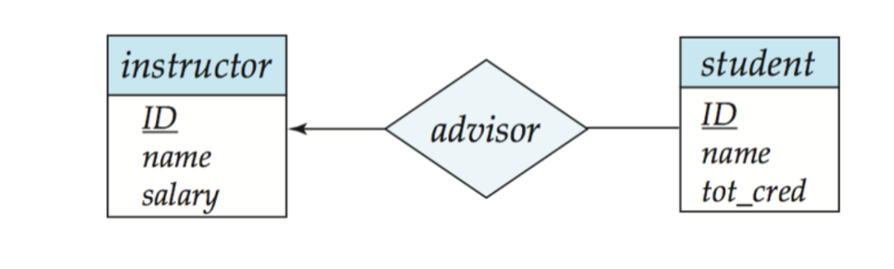
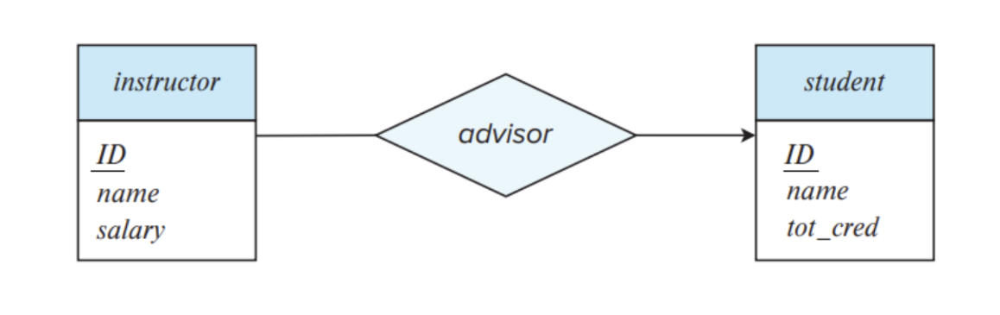
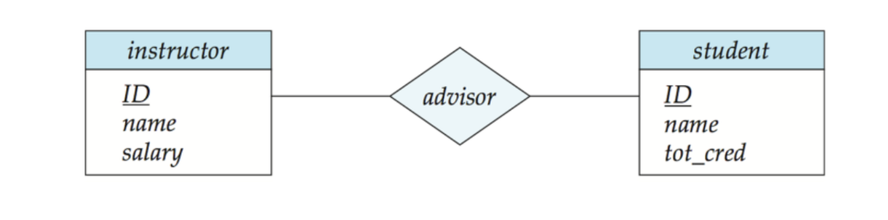
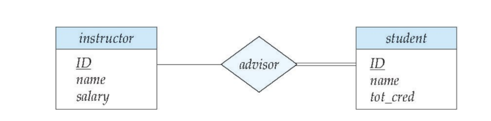
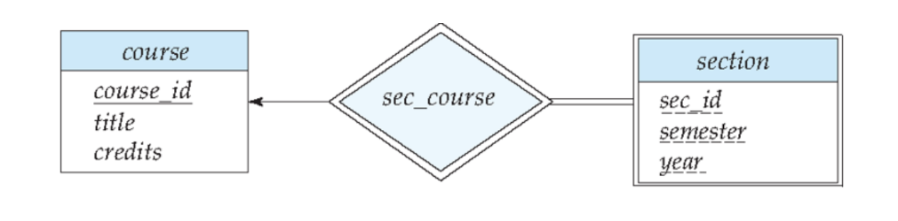

## Learning Objectives

After this chapter, students should be able to:

- identify entity sets, relationship sets, attributes, candidate keys, and weak entities;
- read cardinality, participation, and key constraints from a Chen-style ER diagram;
- map strong/weak entities and common relationship types into relational tables with keys and foreign keys.

# Introduction to Entity Sets

The Entity-Relationship (ER) model is a high-level conceptual data model that helps in designing the schema of a database. It allows us to describe the data involved in a real-world enterprise in terms of objects and their relationships.

- **Entity**: An entity is an object that exists and is distinguishable from other objects. For example, a specific student named "Alice" is an entity.
- **Entity Set**: An entity set is a collection of entities of the same type that share the same properties or attributes. For example, the set of all students in a university forms an entity set.

An **entity type** describes the common structure (such as `Student`), while an **entity instance** is one particular member (such as the student with roll number `26f10`). In a database design, attributes describe entities and relationships; their **domain** is the set of values they may take.

## Keys and Relationships

- **Superkey**: An attribute set that uniquely identifies an entity. It may contain extra attributes that are not needed for uniqueness.
- **Candidate key**: A minimal superkey; removing any attribute would make it stop being unique.
- **Primary key**: The candidate key selected as the main identifier. Other candidate keys are alternate keys.
- **Composite key**: A key made from more than one attribute, such as `(course_id, sec_id, semester, year)` for a course section.
- **Relationship set**: A set of associations among entity sets. A relationship instance connects particular entity instances, such as one student taking one section.
- **Relationship degree**: The number of participating entity sets. A recursive (unary) relationship connects an entity set to itself; a binary relationship connects two sets; a ternary relationship connects three.

An entity may take part in the same relationship more than once. In a recursive relationship such as `prereq`, role names distinguish the roles: one course is the course being taken, and the other is its prerequisite.

## Strong Entity Set
- A strong entity set is an entity set that contains sufficient attributes to uniquely identify all its entities.
- A strong entity set always has a **Primary Key**.

## Weak Entity Set
- A weak entity set is an entity set that does not contain sufficient attributes to uniquely identify its entities on its own.
- A primary key does not exist for a weak entity set.
- Instead, it contains a partial key called a **Discriminator**. The discriminator is represented in an ER diagram by underlining the attribute with a **dashed line**.

### Characteristics of Weak Entity Sets
- A weak entity set cannot exist independently since it doesn't have a primary key. It depends on a strong entity set.
- It features in the model in relationship with a strong entity set. This dependency is called an **identifying relationship**.
- The primary key of a weak entity set is formed by combining its discriminator with the primary key of the strong entity set it depends on.
- **Primary key of weak entity set = Discriminator + Primary key of Strong entity set**.
- A weak entity set must have **total participation** in its identifying relationship.

---

# Attributes

An attribute is a property or characteristic associated with an entity set. For example, the `Student` entity set might have attributes like `Name`, `Age`, and `Roll Number`.

### Types of Attributes

- **Simple attribute**: An attribute that cannot be divided into smaller sub-parts (e.g., `Age`).
- **Composite attribute**: An attribute that can be divided into smaller sub-parts. For example, a `Name` attribute can be divided into `First Name`, `Middle Name`, and `Last Name`.
- **Single-valued attribute**: An attribute that holds a single value for a specific entity (e.g., `Roll Number`).
- **Multivalued attribute**: An attribute that can hold multiple values for a specific entity. For example, a student might have multiple phone numbers (`{phone_numbers}`).
- **Derived attribute**: An attribute whose value is calculated (derived) from the value of another attribute. For example, `Age()` can be derived from the `Date of Birth` attribute.

A **relationship attribute** describes an association rather than an entity. For example, `grade` describes a student's `takes` relationship with a particular section; storing it only on `Student` would lose which course earned that grade.

{width=50%}

---

# Entity-Relationship (ER) Diagrams

An ER diagram is a visual representation of the ER model. The standard notation involves:

- **Rectangles**: Represent entity sets.
- **Ellipses**: Attributes are listed inside ellipses and connected to the entity set.
- **Solid Underline**: Indicates a primary key attribute.
- **Diamonds**: Represent relationship sets.
- **Double Lines**: Indicate total participation of an entity in a relationship.
- **Double Rectangles**: Represent weak entity sets.
- **Double Diamonds**: Represent identifying relationship sets for weak entity sets.

## Worked Example: University Database

The university schema below ties together students, instructors, departments, courses, sections, classrooms, and time slots. Read it from the entity rectangles outward: identify what is stored, then follow each relationship diamond to see how records connect.

{width=95%}

### Reading the Diagram

| Concept | Where it appears | Meaning in this example |
|---|---|---|
| Strong entity and key | `department`, `instructor`, `student`, `course`, `classroom`, and `time_slot` rectangles; underlined attributes | Each strong entity has its own key, such as `ID`, `course_id`, or `dept_name`. An underlined attribute identifies an entity instance. |
| Weak entity and identifying relationship | Double rectangle `section`; double diamond `sec_course` | A section is identified in the context of its course. Its `sec_id` is a partial key; together with the course key and the other section key attributes, it identifies a section offering. The double line indicates total participation: a section cannot exist without its course. |
| 1:N relationships | `course_dept`, `inst_dept`, and `stud_dept` | The arrow marks the “at most one” side. For example, each course belongs to at most one department, while a department can be related to many courses. |
| Advising relationship | `advisor` between `student` and `instructor` | The arrow toward `instructor` means each student has at most one advisor; an instructor may advise many students. |
| M:N relationships | `teaches` and `takes` | Instructors may teach multiple sections and sections may involve multiple instructors where permitted by the schema; students take sections and each section can have many students. Double lines show total participation where present. |
| Relationship attribute | `grade` connected to `takes` | A grade belongs to a student's enrollment in a section, not to the student or section by itself. |
| Recursive relationship | `prereq` from `course` back to `course` | A course can require another course. The role labels `course_id` and `prereq_id` distinguish the course from its prerequisite. |
| Scheduling relationships | `sec_time_slot` and `sec_class` | Each section is associated with a time slot and classroom; the arrows show the key constraints for those associations. |

**How to read the symbols:** rectangles are entity sets, diamonds are relationships, and underlined attributes are keys. A double rectangle marks a weak entity; its identifying relationship is a double diamond. Arrows show key constraints (“at most one” on the arrow side), while double lines show total participation (“every entity on this side must participate”).

**What this diagram does not show:** it is a core ER model, not an EER model. Composite, multivalued, and derived attributes are illustrated in [the attribute-types figure](attributes.png). Specialization/generalization, ternary relationships, and aggregation are introduced in [Advanced ER Concepts](03_advanced_er_concepts.qmd) with their own diagrams.

> **Design check:** An arrow gives an “at most one” constraint, not a guarantee that a relationship exists. Use a double line when participation is mandatory. Always confirm both rules with the real requirements before translating an ER diagram into tables.

---

# Mapping Cardinalities (Relationship Types)

Mapping cardinality describes the **maximum** number of relationship instances in which an entity may participate with entities on the other side. It does not by itself say whether participation is required; that is a separate constraint described below.

## One-to-One (1:1) Relationship
- Each entity in $A$ is associated with at most one entity in $B$.
- Each entity in $B$ is associated with at most one entity in $A$.
- *Example*: Each instructor has at most one student, and each student has at most one instructor.

{width=70%}

## One-to-Many (1:N) Relationship
- One entity in $A$ may be associated with many entities in $B$.
- Each entity in $B$ is associated with at most one entity in $A$.
- *Example*: An instructor can advise multiple students, but each student has only one instructor.

{width=70%}

## Many-to-One (N:1) Relationship
- Each entity in $A$ is associated with at most one entity in $B$.
- One entity in $B$ may be associated with many entities in $A$.
- *Example*: Many students can be advised by the same instructor, but each student has at most one instructor.

{width=70%}

## Many-to-Many (M:N) Relationship
- One entity in $A$ may be associated with many entities in $B$.
- One entity in $B$ may be associated with many entities in $A$.
- *Example*: An instructor can advise multiple students, and a student can have multiple instructors.

{width=70%}

---

# Total and Partial Participation

Participation constraints dictate whether the existence of an entity depends on its being related to another entity via the relationship type.

- **Total Participation**: Every entity in the entity set must participate in at least one relationship in the relationship set. Indicated by a double line.
- **Partial Participation**: Some entities may not participate in any relationship in the relationship set. Indicated by a single line.

*Example*: If every student *must* have an instructor, the `Student` entity set has total participation. If an instructor *may or may not* have a student, the `Instructor` entity set has partial participation.

{width=80%}

**Do not confuse the two constraints:** `1:N` says that a student can have at most one advisor; it does not say that every student has an advisor. Total participation adds the minimum of one. In min-max notation, a student who must have exactly one advisor has `(1,1)`, while an instructor who may advise any number of students has `(0,N)`. Together, min-max constraints express both optionality and maximum cardinality.

---

# Expressing Weak Entity Sets in ER Diagrams

As discussed earlier, a weak entity set does not have a primary key and depends on a strong entity set. In an ER diagram, we denote the weak entity set with a double rectangle, its identifying relationship with a double diamond, and its discriminator attribute with a dashed underline.

{width=80%}

---

# Mapping an ER Design to Relational Tables

ER modeling describes the concepts and constraints; relational mapping turns that design into tables, keys, and foreign keys. These are standard mapping rules, not a replacement for checking the actual business requirements.

## Strong Entity Sets

Create one relation for each strong entity set. Include its simple attributes (expand a composite attribute into its component attributes), and choose a candidate key as the primary key. A derived attribute is usually omitted and computed when needed; store it only when there is a deliberate performance reason and a plan to keep it consistent.

For example, `Course(course_id, title, credits)` uses `course_id` as its primary key.

## Weak Entity Sets

Create a relation for the weak entity. Include its attributes, the primary key of its owner as a foreign key, and its partial key. The primary key combines the owner's key with the weak entity's partial key.

For a section identified within a course, a possible mapping is `Section(course_id, sec_id, semester, year, building, room_number)`, with primary key `(course_id, sec_id, semester, year)` and `course_id` referencing `Course`. This is why the same `sec_id` may be reused for different courses or terms.

## Relationship Sets

| Relationship type | Common mapping rule | Example |
|---|---|---|
| 1:N | Put the primary key of the 1-side as a foreign key in the N-side relation. Store relationship attributes there too. | `Course` stores `dept_name` as a foreign key to `Department`. |
| 1:1 | Put one side's key as a foreign key in the other; prefer the side with total participation. Add `UNIQUE` to enforce the 1:1 maximum and `NOT NULL` if participation is total on that side. | `Department` may store a unique, non-null chair `instructor_id`. |
| M:N | Create a new relation containing the primary keys of both entity sets as foreign keys. Their combination is often the primary key; include relationship attributes. | `Takes(student_id, course_id, sec_id, semester, year, grade)`, keyed by the student key plus the section's composite key. |
| Multivalued attribute | Create a separate relation with the owner key and one value per row. Their combination is usually the primary key. | `StudentPhone(student_id, phone_number)`. |
| Ternary or higher-degree | Create a relation with foreign keys to every participating entity set, plus relationship attributes. Choose a key from the cardinality constraints. | `Assignment(instructor_id, student_id, project_id, assigned_on)`. |
| Recursive | For 1:N, use a self-referencing foreign key. For M:N, use a separate relation with role-named foreign keys to the same entity table. | `Prerequisite(course_id, prerequisite_id)` has two foreign keys to `Course`. |

For a 1:N relationship, placing the foreign key on the N-side avoids creating a separate table for each association. For M:N, a foreign key in just one of the two entity tables cannot represent all pairings; the relationship table is necessary.

Foreign keys enforce that a referenced row exists, `UNIQUE` enforces an at-most-one constraint, and `NOT NULL` enforces that a foreign-key value is present. Some total-participation constraints (especially for M:N relationships) cannot be expressed by a simple foreign key alone and may need assertions, triggers, or application-level transaction rules, depending on the DBMS.

## Mapping Specialization

There is more than one valid way to map a superclass and its subclasses. Common strategies are:

1. Create a superclass table and one table per subclass. Each subclass key is also a foreign key to the superclass. This naturally supports overlapping and partial specialization.
2. Create one table for the whole hierarchy with a type discriminator. This is simple for disjoint specialization but may introduce many nullable subclass attributes.
3. For a disjoint and complete specialization, create one table per subclass, repeating the superclass attributes in each. This avoids a separate superclass table but complicates shared references and updates.

Choose a strategy by checking the disjointness/completeness rules, query patterns, and integrity constraints. No mapping strategy removes the need to enforce the original ER constraints.

### Mapping Checklist

- Does each entity relation have a primary key?
- Does each weak entity key include its owner's key?
- Are 1:N foreign keys placed on the many side?
- Are M:N and multivalued facts stored in separate relations?
- Are relationship attributes stored with the relationship they describe?
- Can the chosen tables enforce the diagram's participation and cardinality constraints?

## ER Design Review

For the university diagram above, explain how you would map each of these facts:

1. A department offers many courses, and each course belongs to one department.
2. A student takes a section and receives a grade for that enrollment.
3. A section number is unique only within its course offering.
4. A course may list other courses as prerequisites.

**Check your design:** Store the department key as a foreign key on the many-side `Course`; represent `takes` in its own relation with student and section keys plus `grade`; identify a section using the owner course key and its partial key (along with any term/section key components required by the schema); represent the recursive prerequisite relationship with two role-named foreign keys to `Course`.
