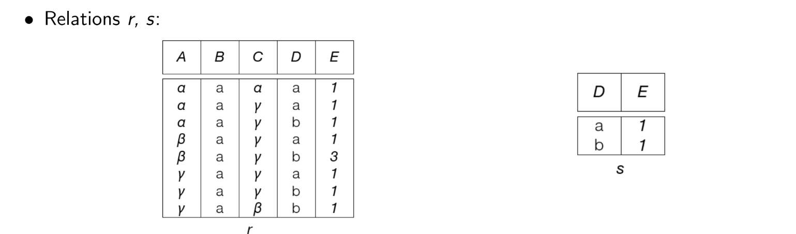

# Relational Algebra

### Filter and project

Find names of students older than 25 or enrolled in Maths:

`Students(RollNo, Name, Age, Subject)`

$$
\pi_{Name}(\sigma_{Age>25 \lor Subject='Maths'}(Students))
$$

### Join relations

Find the names and sports of students under 25 with more than three awards:

`Students(RollNo, Name, Age)`  
`Activity(RollNo, Sports, Awards)`

$$
\pi_{Name,Sports}(\sigma_{Age<25 \land Awards>3}(Students \bowtie Activity))
$$

The natural join matches the shared `RollNo` attribute.

### Translate a query across three relations

Use these relations:

- `Student(student_id, name)`
- `Enrollment(student_id, course_id, grade)`
- `Course(course_id, title)`

Find students who received an A in DBMS:

| Language | Query |
|---|---|
| SQL | `SELECT DISTINCT s.name FROM Student s JOIN Enrollment e ON e.student_id = s.student_id JOIN Course c ON c.course_id = e.course_id WHERE c.title = 'DBMS' AND e.grade = 'A';` |
| RA | $\pi_{name}(\sigma_{title='DBMS'\land grade='A'}(Student\bowtie Enrollment\bowtie Course))$ |
| TRC | $\{t \mid \exists s\in Student\ \exists e\in Enrollment\ \exists c\in Course\ (t[name]=s[name]\land s[student\_id]=e[student\_id]\land e[course\_id]=c[course\_id]\land c[title]='DBMS'\land e[grade]='A')\}$ |
| DRC | $\{\langle n\rangle \mid \exists sid,cid,g,title\ (\langle sid,n\rangle\in Student\land\langle sid,cid,g\rangle\in Enrollment\land\langle cid,title\rangle\in Course\land title='DBMS'\land g='A')\}$ |

The joins connect the student, enrollment, and course rows. `DISTINCT` matches the set results of RA and calculus.

### Division

Division expresses “for every.” If $r(A,B,C)$ and $s(B,C)$, then $r\div s$ returns the values of $A$ paired with every tuple in $s$.

{width=80%}

In the example, the result contains the values of $A$ associated with all tuples in the divisor.

# Translate Between SQL, RA, TRC, and DRC

The following examples use `student(roll_no, name, level, course, term, grade)`. In DRC, variables $r,n,l,c,tm,g$ follow that attribute order. SQL uses `DISTINCT` where needed to match set semantics.

For each query, identify the output columns, source relations, and conditions. These correspond to SQL's `SELECT`, `FROM`, and `WHERE`; RA's projection, relation input, and selection; and the output variables and predicates in TRC/DRC.

### Filter rows and return a name

Find students enrolled in DBMS who received an A.

| Language | Query |
|---|---|
| SQL | `SELECT DISTINCT name FROM student WHERE course = 'DBMS' AND grade = 'A';` |
| RA | $\pi_{name}(\sigma_{course='DBMS'\land grade='A'}(student))$ |
| TRC | $\{t \mid \exists s\in student\ (t[name]=s[name]\land s[course]='DBMS'\land s[grade]='A')\}$ |
| DRC | $\{\langle n\rangle \mid \exists r,l,c,tm,g\ (\langle r,n,l,c,tm,g\rangle\in student\land c='DBMS'\land g='A')\}$ |

### Combine conditions

Find Degree students enrolled in DBMS during `27t1`.

| Language | Query |
|---|---|
| SQL | `SELECT DISTINCT roll_no, name FROM student WHERE level = 'Degree' AND course = 'DBMS' AND term = '27t1';` |
| RA | $\pi_{roll\_no,name}(\sigma_{level='Degree'\land course='DBMS'\land term='27t1'}(student))$ |
| TRC | $\{t \mid \exists s\in student\ (t[roll\_no]=s[roll\_no]\land t[name]=s[name]\land s[level]='Degree'\land s[course]='DBMS'\land s[term]='27t1')\}$ |
| DRC | $\{\langle r,n\rangle \mid \exists l,c,tm,g\ (\langle r,n,l,c,tm,g\rangle\in student\land l='Degree'\land c='DBMS'\land tm='27t1')\}$ |

### Alternatives with `OR` / `IN`

Find DBMS students who received an A or S.

| Language | Query |
|---|---|
| SQL | `SELECT DISTINCT name FROM student WHERE course = 'DBMS' AND grade IN ('A', 'S');` |
| RA | $\pi_{name}(\sigma_{course='DBMS'\land(grade='A'\lor grade='S')}(student))$ |
| TRC | $\{t \mid \exists s\in student\ (t[name]=s[name]\land s[course]='DBMS'\land(s[grade]='A'\lor s[grade]='S'))\}$ |
| DRC | $\{\langle n\rangle \mid \exists r,l,c,tm,g\ (\langle r,n,l,c,tm,g\rangle\in student\land c='DBMS'\land(g='A'\lor g='S'))\}$ |

### Translate SQL to DRC

```sql
SELECT DISTINCT roll_no, course
FROM student
WHERE level = 'Degree';
```

$$
\{\langle r,c\rangle \mid \exists n,l,tm,g\ (\langle r,n,l,c,tm,g\rangle\in student\land l='Degree')\}
$$

The free variables become the output columns; the remaining variables are quantified.

### Find students in both courses

Find students enrolled in both DBMS and Math.

| Language | Query |
|---|---|
| SQL | `SELECT DISTINCT d.roll_no, d.name FROM student AS d WHERE EXISTS (SELECT 1 FROM student AS m WHERE m.roll_no = d.roll_no AND m.course = 'Math') AND d.course = 'DBMS';` |
| RA | $\pi_{roll\_no,name}(\sigma_{course='DBMS'}(student))\cap\pi_{roll\_no,name}(\sigma_{course='Math'}(student))$ |
| TRC | $\{t \mid \exists d\in student\ (t[roll\_no]=d[roll\_no]\land t[name]=d[name]\land d[course]='DBMS'\land\exists m\in student\ (m[roll\_no]=d[roll\_no]\land m[course]='Math'))\}$ |
| DRC | $\{\langle r,n\rangle \mid \exists l_1,tm_1,g_1,l_2,tm_2,g_2\ (\langle r,n,l_1,'DBMS',tm_1,g_1\rangle\in student\land\langle r,n,l_2,'Math',tm_2,g_2\rangle\in student)\}$ |

### Find students in one course but not another

Find DBMS students who are not enrolled in Math.

| Language | Query |
|---|---|
| SQL | `SELECT DISTINCT d.roll_no, d.name FROM student AS d WHERE d.course = 'DBMS' AND NOT EXISTS (SELECT 1 FROM student AS m WHERE m.roll_no = d.roll_no AND m.course = 'Math');` |
| RA | $\pi_{roll\_no,name}(\sigma_{course='DBMS'}(student))-\pi_{roll\_no,name}(\sigma_{course='Math'}(student))$ |
| TRC | $\{t \mid \exists d\in student\ (t[roll\_no]=d[roll\_no]\land t[name]=d[name]\land d[course]='DBMS'\land\neg\exists m\in student\ (m[roll\_no]=d[roll\_no]\land m[course]='Math'))\}$ |
| DRC | $\{\langle r,n\rangle \mid (\exists l,c,tm,g\ (\langle r,n,l,c,tm,g\rangle\in student\land c='DBMS'))\land\neg\exists l_2,tm_2,g_2\ (\langle r,n,l_2,'Math',tm_2,g_2\rangle\in student)\}$ |

### Find students with no A grade

| Language | Query |
|---|---|
| SQL | `SELECT DISTINCT s.roll_no, s.name FROM student AS s WHERE NOT EXISTS (SELECT 1 FROM student AS a WHERE a.roll_no = s.roll_no AND a.grade = 'A');` |
| RA | $\pi_{roll\_no,name}(student)-\pi_{roll\_no,name}(\sigma_{grade='A'}(student))$ |
| TRC | $\{t \mid \exists s\in student\ (t[roll\_no]=s[roll\_no]\land t[name]=s[name]\land\neg\exists a\in student\ (a[roll\_no]=s[roll\_no]\land a[grade]='A'))\}$ |
| DRC | $\{\langle r,n\rangle \mid (\exists l,c,tm,g\ (\langle r,n,l,c,tm,g\rangle\in student))\land\neg\exists l_2,c_2,tm_2\ (\langle r,n,l_2,c_2,tm_2,'A'\rangle\in student)\}$ |

### Find students taking every required course

`required_course(course)` lists the required courses.

| Language | Query |
|---|---|
| SQL | `SELECT DISTINCT s.roll_no, s.name FROM student AS s WHERE NOT EXISTS (SELECT 1 FROM required_course AS r WHERE NOT EXISTS (SELECT 1 FROM student AS e WHERE e.roll_no = s.roll_no AND e.course = r.course));` |
| RA | $\pi_{roll\_no,name}(student\bowtie(\pi_{roll\_no,course}(student)\div required\_course))$ |
| TRC | $\{t \mid \exists s\in student\ (t[roll\_no]=s[roll\_no]\land t[name]=s[name]\land\forall q\in required\_course\ \exists e\in student\ (e[roll\_no]=s[roll\_no]\land e[course]=q[course]))\}$ |
| DRC | $\{\langle r,n\rangle \mid (\exists l,c,tm,g\ (\langle r,n,l,c,tm,g\rangle\in student))\land\forall q\ (\langle q\rangle\in required\_course\rightarrow\exists l_2,tm_2,g_2\ (\langle r,n,l_2,q,tm_2,g_2\rangle\in student))\}$ |

“Every” corresponds to division or universal quantification. The nested `NOT EXISTS` means there is no required course without a matching enrollment.

### Inequality and SQL `NULL`

Find DBMS students with a non-C grade.

| Language | Query |
|---|---|
| SQL | `SELECT DISTINCT roll_no, name FROM student WHERE course = 'DBMS' AND grade <> 'C';` |
| RA | $\pi_{roll\_no,name}(\sigma_{course='DBMS'\land grade\ne 'C'}(student))$ |
| TRC | $\{t \mid \exists s\in student\ (t[roll\_no]=s[roll\_no]\land t[name]=s[name]\land s[course]='DBMS'\land s[grade]\ne 'C')\}$ |
| DRC | $\{\langle r,n\rangle \mid \exists l,c,tm,g\ (\langle r,n,l,c,tm,g\rangle\in student\land c='DBMS'\land g\ne 'C')\}$ |

SQL excludes rows where `grade` is `NULL`; include them with `OR grade IS NULL`.

### SQL features beyond basic RA and calculus

Basic RA and calculus do not express aggregation or ordering. SQL handles these directly:

```sql
SELECT course, COUNT(*) AS enrollment_count
FROM student
GROUP BY course;
```

```sql
SELECT DISTINCT course
FROM student
ORDER BY course;
```

Classical RA and calculus also use two-valued logic. SQL comparisons with `NULL` evaluate to `UNKNOWN`; for example, `grade <> 'C'` does not include rows where `grade` is `NULL`.
