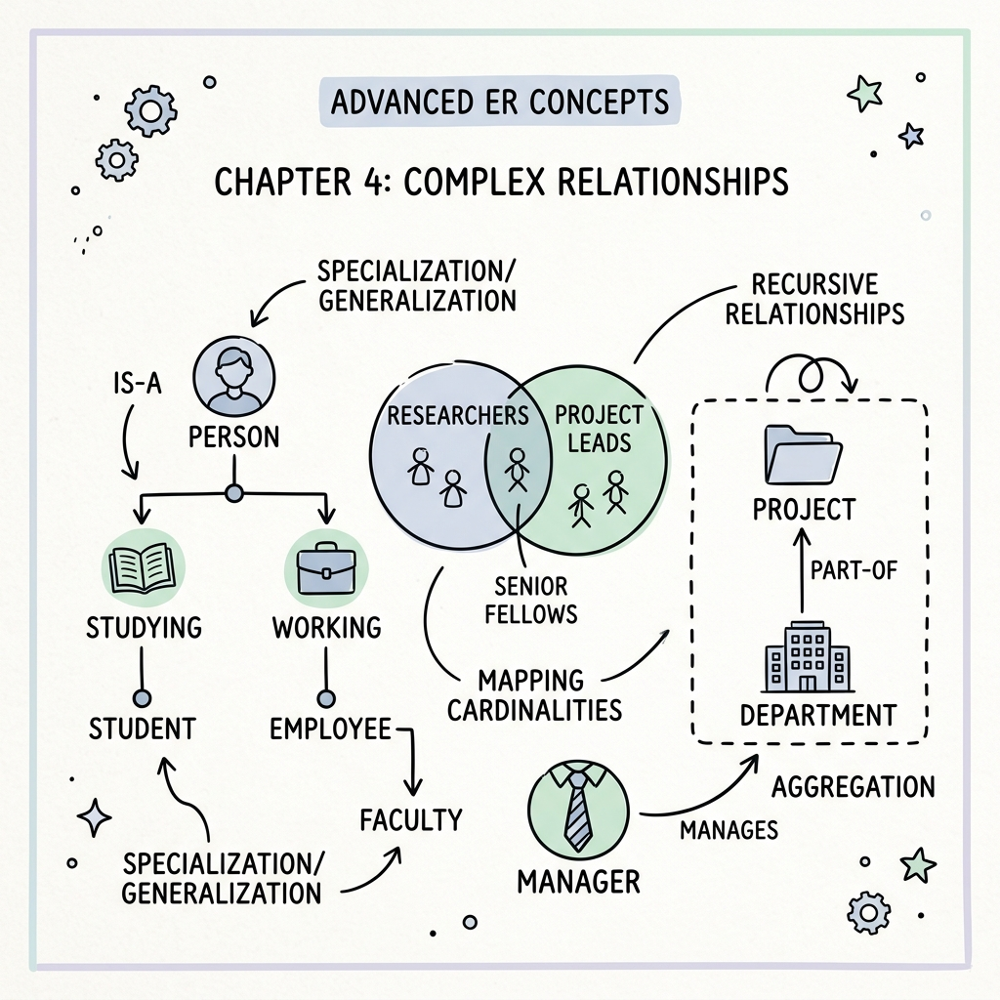
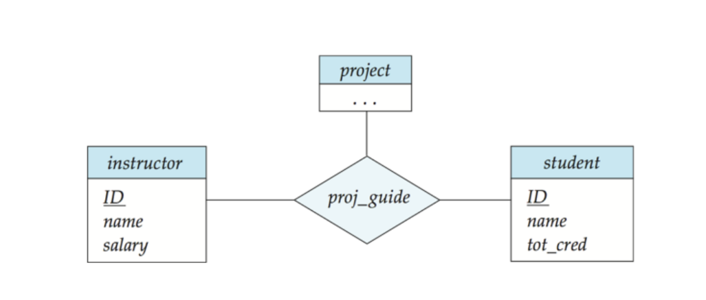
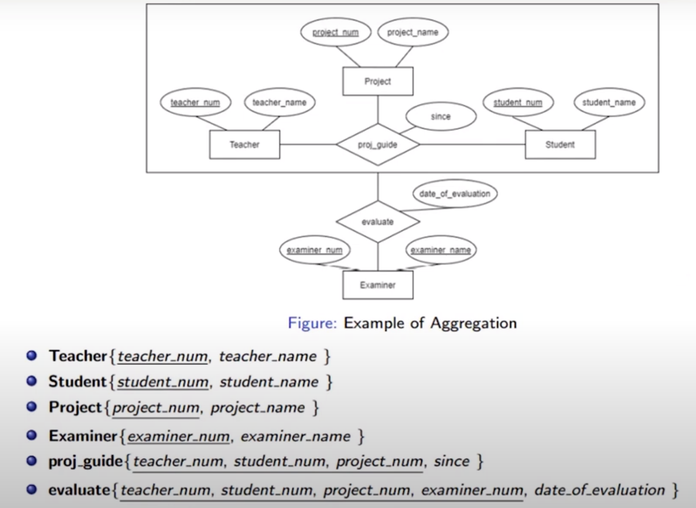
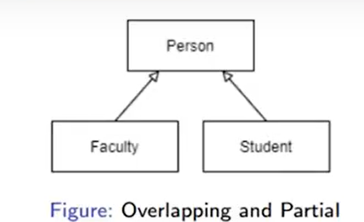
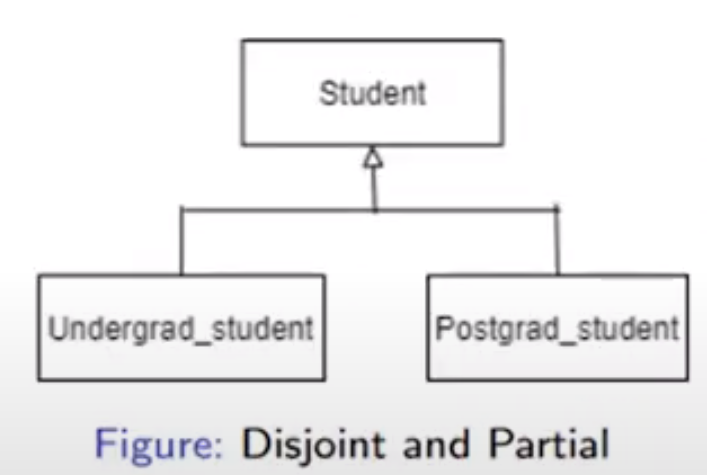
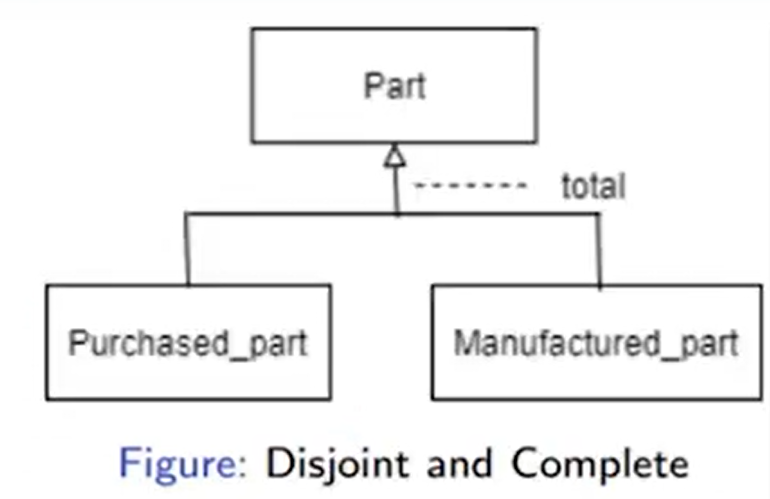
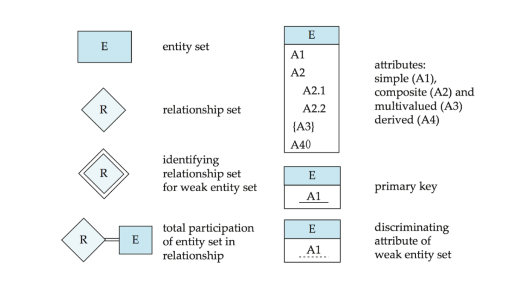

## Learning Objectives

After this chapter, students should be able to:

- recognize when a relationship is ternary and when a relationship should be aggregated;
- distinguish specialization from generalization;
- specify and interpret disjoint/overlapping and complete/partial subclass constraints.

The **Enhanced Entity-Relationship (EER) model** extends the basic ER model with constructs for richer constraints and abstractions. The most common are higher-degree relationships, aggregation, and superclass/subclass hierarchies. Use an extension only when it expresses a real requirement more clearly than the basic model.

# Ternary Relationships

A **ternary relationship** is one relationship set whose instances simultaneously associate entities from three entity sets. Its degree is three. A relationship instance represents one fact involving all three participants, rather than three independent pairwise facts.

*Example*: Consider an instructor assigning a project to a student. The fact `Assigns(Instructor-17, Project-4, Student-32)` means that this instructor assigned this project to this student. If the business fact is the specific triple, model it as one ternary relationship, with attributes such as `assigned_on` attached to that relationship.

{width=80%}

**Why not replace it with three binary relationships?** Separate links such as “instructor works on project,” “student works on project,” and “instructor advises student” do not necessarily say which instructor assigned which project to which student. Joining those pairwise facts can create combinations that were never assigned. Decompose a ternary relationship only when the original constraints prove the decomposition preserves exactly the same facts.

**How to model it:** Put all three participating entity sets at the same relationship diamond. When mapping to relations, create a relation containing their keys and any attributes of the relationship. The keys and constraints depend on the cardinalities on each role; do not assume all three foreign keys must always form the key without checking the requirements.

---

# Aggregation

**Aggregation** is an abstraction that lets a relationship set participate in another relationship. A box is drawn around the original relationship and its participating entities, treating that structure as a higher-level unit.

*When to use aggregation:* Use it when the new fact refers to a particular instance of an existing relationship, not just independently to each of its entities.

*Example*: Suppose an `Instructor` advises a `Student`, and a project is assigned to that specific advising pair. The assignment is about the particular `Advises` instance. Aggregate the `Advises` relationship and connect that aggregate to `Project` with `Assigned`.

{width=80%}

**Ternary or aggregation?** If the requirement is simply “this instructor assigns this project to this student,” a ternary relationship is a natural model. If it says “this project is assigned to the instructor-student advising relationship,” aggregation makes the dependency explicit. These models express different constraints and should not be treated as interchangeable diagrams.

---

# Extended ER Features: Specialization and Generalization

**Specialization** is a top-down process: divide a superclass into subclasses based on distinguishing properties. **Generalization** is a bottom-up process: combine similar entity sets into a superclass that captures their common properties. An `ISA` relationship indicates that each subclass entity is also a member of the superclass and inherits its key and common attributes.

For example, `Person` may be specialized into `Student` and `Instructor`. `Person` stores attributes common to both; `Student` and `Instructor` store their role-specific attributes. One person can belong to both subclasses if the hierarchy is overlapping.

Every specialization should specify two independent constraints: **disjointness** (whether an entity may belong to multiple subclasses) and **completeness** (whether every superclass entity must belong to at least one subclass).

## Disjointness Constraints

- **Disjoint**: An entity can belong to *at most one* lower-level entity set (subclass).
- **Overlapping**: An entity can belong to *more than one* lower-level entity set simultaneously.

## Completeness Constraints

- **Complete (Total)**: Every entity in the higher-level entity set (superclass) *must* belong to at least one lower-level entity set.
- **Partial**: Some entities in the higher-level entity set *might not* belong to any lower-level entity set.

The two choices combine into four valid patterns:

| Specialization | Disjointness rule | Completeness rule | Example |
|---|---|---|---|
| Disjoint, partial | At most one subclass | May belong to no subclass | A student may be UG or PG, but visiting/diploma students may be neither. |
| Disjoint, complete | At most one subclass | Must belong to one subclass | Every part is either purchased or manufactured, never both. |
| Overlapping, partial | May belong to multiple subclasses | May belong to no subclass | A person may be a student, an instructor, both, or neither. |
| Overlapping, complete | May belong to multiple subclasses | Must belong to at least one subclass | Every staff member must be faculty or administrator, and may be both. |

“Disjoint” does not mean that the subclasses have no attributes in common; it means one entity cannot be a member of two of those subclasses at once. “Complete” does not mean that every subclass is nonempty; it means every superclass entity belongs to at least one subclass.

### Reading the Constraint Diagrams

The labels in the three diagrams combine the two independent choices. Read them as rules about the same superclass, not as rules between subclasses. The fourth combination, Overlapping and Complete, follows from the definitions in the table above. In database constraints, disjointness and completeness must be enforced even if the chosen table layout does not enforce them automatically.

### Common Design Mistakes

- **Using a ternary relationship when two relationships are enough:** model the actual fact and its constraints, not just the number of entity sets in a sentence.
- **Replacing a ternary relationship with binary relationships without checking loss:** the decomposition may allow spurious combinations or lose which participants formed one fact.
- **Using aggregation when the relationship is not itself being related:** if a project only refers independently to an instructor and a student, a ternary relationship may be clearer.
- **Leaving ISA constraints implicit:** document whether subclasses overlap and whether the specialization is complete.
- **Putting attributes at the wrong level:** shared attributes belong to the superclass; role-specific attributes belong to a subclass; attributes describing an association belong to its relationship.

### Review Questions

1. How can you tell whether a fact is ternary, or whether it is an ordinary relationship between an entity and an existing relationship?
2. A person may be a student, an instructor, both, or neither. Is this specialization disjoint or overlapping, complete or partial?
3. Every account must be either checking or savings, never both. Which two constraints apply?
4. Why can a set of three binary relationships fail to preserve a ternary assignment fact?

### 1. Overlapping and Partial

{width=80%}

### 2. Disjoint and Partial

{width=80%}

### 3. Disjoint and Complete

{width=80%}

### 4. Overlapping and Complete

Every superclass entity belongs to at least one subclass, and an entity may belong to more than one. For example, every university employee might be a faculty member, an administrator, or both. The existing figures do not include a dedicated diagram for this combination; the rule follows directly from **overlapping** plus **complete**.

---

# Summary

The concepts covered in the Entity-Relationship model can be summarized below. ER diagrams provide a standard language to communicate database schemas between developers, designers, and stakeholders.

- Use a ternary relationship when one fact depends on three participants together; use aggregation when another relationship refers to a particular relationship instance.
- Specialization creates subclasses from a superclass; generalization combines entity sets around their shared properties.
- Disjointness controls whether an entity may be in multiple subclasses; completeness controls whether every superclass entity must be in at least one subclass.

