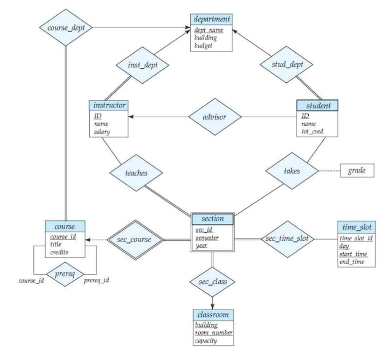

# University Database

This ER diagram shows how university people, courses, and facilities are connected. Read rectangles as entity sets, diamonds as relationships, and follow the connecting lines to see the constraints.

{width=95%}

## Entities and keys

- **Strong entities:** `student`, `instructor`, `department`, `course`, `classroom`, and `time_slot` have underlined key attributes.
- **Weak entity:** `section` depends on `course`. The double rectangle and double diamond `sec_course` mark this dependency. A section is identified by its course and its section details (`sec_id`, `semester`, and `year`).

## Relationships and constraints

| Relationship | How to read it |
|---|---|
| `course_dept`, `inst_dept`, `stud_dept` | Courses, instructors, and students are associated with departments. Each arrow toward `department` means each participating entity is associated with at most one department. |
| `advisor` | Connects students to instructors. The arrow toward `instructor` means each student has at most one advisor. |
| `teaches` | Connects instructors and sections; the diagram allows many-to-many participation. |
| `takes` | Connects students and sections. `grade` describes a student's result for that section, not a property of the student alone. |
| `prereq` | Connects a course to another course. The role names `course_id` and `prereq_id` distinguish the course from its prerequisite. |
| `sec_time_slot`, `sec_class` | Connect sections to time slots and classrooms. The arrow toward `classroom` means each section is associated with at most one classroom. |

## Reading the notation

- An **arrow** marks the “at most one” side; it does not mean participation is mandatory.
- A **double line** means every entity on that side must participate in the relationship.
- A **double rectangle** marks a weak entity; its **double diamond** is the identifying relationship.
- An underlined attribute is a key; a dashed underline marks a partial key.

This is a core ER diagram. See [Advanced ER Concepts](03_advanced_er_concepts.qmd) for specialization, ternary relationships, and aggregation.
