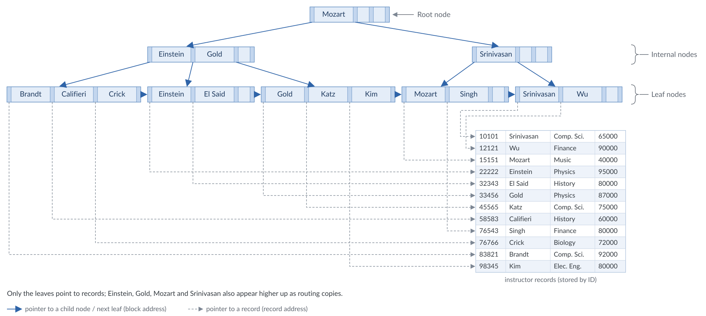
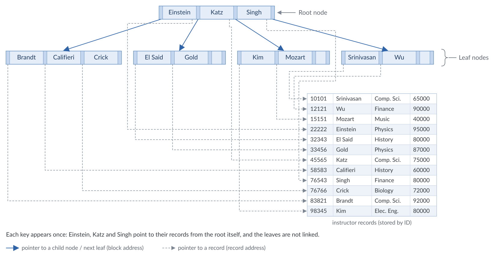

## Why Trees for Indexing?

The multilevel index from Section 1 was a good idea, but it had one major problem: as the file grows, overflow blocks pile up and performance degrades. You eventually need to reorganize the whole file — expensive and disruptive.

Tree-based structures solve this by **self-balancing on every insert and delete**, keeping search cost at $O(\log n)$ always, without any manual reorganization.

---

## The 2-3-4 Tree: Motivation

The problem with BSTs on disk is that each **node holds only one key and has only two children**. The tree must be very tall ($O(\log n)$ levels) to hold $n$ records.

What if we could make each node **fatter** — storing multiple keys and having multiple children? Then the tree would be much **shorter**, and we'd need far fewer disk reads to reach any record. This idea leads to the **2-3-4 Tree**.

---

## What Is a 2-3-4 Tree?

A 2-3-4 Tree is a balanced search tree where every node can hold **1, 2, or 3 keys** (and correspondingly have **2, 3, or 4 children**). That is where the name comes from.

**The three node types:**

| Node type | Keys stored | Children | Search key rule |
|:---:|:---:|:---:|---|
| **2-node** | 1 (call it S) | 2 | left child < S; right child > S |
| **3-node** | 2 (S and L) | 3 | left < S; middle: S–L; right > L |
| **4-node** | 3 (S, M, L) | 4 | left < S; second: S–M; third: M–L; right > L |

A leaf node can hold 1, 2, or 3 data items.

**Key properties:**

- All leaves sit at the **same depth** — the tree is always perfectly height-balanced.
- $h \sim O(\log n)$, so search, insert, and delete all cost $O(\log n)$.
- Data is always kept in **sorted order**.

---

## Search in a 2-3-4 Tree

Search is a straightforward extension of BST search. At each node, compare the target key against the node's keys and follow the appropriate child pointer. Repeat until you reach a leaf or find the key.

::: {.callout-note title="Key idea"}
Because all leaves are at the same depth, every search takes exactly $O(h) = O(\log n)$ steps — no worst-case skew possible.
:::

---

## Insertion in a 2-3-4 Tree

Insertion always happens at a **leaf**. The process:

1. Search for the expected location (the leaf where the key would go).
2. If the leaf is a **2-node**, expand it to a **3-node** and insert. Done.
3. If the leaf is a **3-node**, expand it to a **4-node** and insert. Done.
4. If the leaf is a **4-node**, we can't add another key — we must **split** it first.

### Node Splitting

Splitting a 4-node takes its **middle key (M)** and pushes it up to the parent. The original 4-node becomes two 2-nodes (one holding S, one holding L), both children of the parent which now absorbs M.

There are three cases depending on the parent:

**Case 1 — Parent is the root (a 4-node):**

```{mermaid}
flowchart LR
    classDef node fill:#e4edf8,stroke:#a9c2e3,color:#1e3a5f
    classDef hit fill:#d6e4f5,stroke:#3b6ea8,stroke-width:3px,color:#1e3a5f
    classDef sub fill:#f1f3f5,stroke:#c5cbd3,color:#5f6670
    subgraph before["Before: a full 4-node"]
        direction TB
        b1["S | M | L"]:::hit
        b2["a"]:::sub
        b3["b"]:::sub
        b4["c"]:::sub
        b5["d"]:::sub
        b1 --> b2
        b1 --> b3
        b1 --> b4
        b1 --> b5
    end
    subgraph after["After: M moves up"]
        direction TB
        a1["M"]:::hit
        a2["S"]:::node
        a3["L"]:::node
        a4["a"]:::sub
        a5["b"]:::sub
        a6["c"]:::sub
        a7["d"]:::sub
        a1 --> a2
        a1 --> a3
        a2 --> a4
        a2 --> a5
        a3 --> a6
        a3 --> a7
    end
    before -- split --> after
    style before fill:#ffffff,stroke:#c5cbd3
    style after fill:#ffffff,stroke:#c5cbd3
```

The tree grows one level taller.

**Case 2 — Parent is a 2-node:**

The middle key M is absorbed into the parent, converting it from a 2-node to a 3-node. The split 4-node's two halves (S and L) become two separate children.

**Case 3 — Parent is a 3-node:**

Same idea — M is absorbed, converting the parent from a 3-node to a 4-node.

### Early vs. Late Splitting

There are two strategies for *when* to split:

- **Early splitting:** Split any 4-node you *encounter* on the way down during a search, before you actually need to. This ensures you never have a full node at the insertion point. At most one split per level.
- **Late splitting:** Only split when you actually need to insert into a 4-node. May cascade up $O(h)$ splits in the worst case.

Both strategies produce valid trees with the same complexity $O(h)$, but they produce different final shapes. The slides follow the **early splitting** strategy.

---

## Insertion Example: Step by Step

In each diagram, the node with a dark border is the one that changed in that step.

Inserting the sequence **10, 30, 60, 20, 50, 40, 70, 80, 15, 90, 100** using the **early splitting** strategy.

---

**After inserting 10, 30, 60** — all three fit into one leaf (a 4-node):

```{mermaid}
flowchart TD
    classDef node fill:#e4edf8,stroke:#a9c2e3,color:#1e3a5f
    classDef hit fill:#d6e4f5,stroke:#3b6ea8,stroke-width:3px,color:#1e3a5f
    classDef sub fill:#f1f3f5,stroke:#c5cbd3,color:#5f6670
    n1["10 | 30 | 60"]:::hit
```

---

**Insert 20** — the root is a 4-node, so we split it *before* descending. Middle key 30 becomes the new root; 10 and 60 become separate children. Then 20 is inserted into the left child:

```{mermaid}
flowchart TD
    classDef node fill:#e4edf8,stroke:#a9c2e3,color:#1e3a5f
    classDef hit fill:#d6e4f5,stroke:#3b6ea8,stroke-width:3px,color:#1e3a5f
    classDef sub fill:#f1f3f5,stroke:#c5cbd3,color:#5f6670
    n1["30"]:::hit
    n2["10 | 20"]:::hit
    n1 --> n2
    n3["60"]:::node
    n1 --> n3
```

---

**Insert 50** — 50 > 30, go right. [60] is a 2-node, so just expand it:

```{mermaid}
flowchart TD
    classDef node fill:#e4edf8,stroke:#a9c2e3,color:#1e3a5f
    classDef hit fill:#d6e4f5,stroke:#3b6ea8,stroke-width:3px,color:#1e3a5f
    classDef sub fill:#f1f3f5,stroke:#c5cbd3,color:#5f6670
    n1["30"]:::node
    n2["10 | 20"]:::node
    n1 --> n2
    n3["50 | 60"]:::hit
    n1 --> n3
```

---

**Insert 40** — 40 > 30, go right. [50, 60] is a 3-node, expand to 4-node and insert:

```{mermaid}
flowchart TD
    classDef node fill:#e4edf8,stroke:#a9c2e3,color:#1e3a5f
    classDef hit fill:#d6e4f5,stroke:#3b6ea8,stroke-width:3px,color:#1e3a5f
    classDef sub fill:#f1f3f5,stroke:#c5cbd3,color:#5f6670
    n1["30"]:::node
    n2["10 | 20"]:::node
    n1 --> n2
    n3["40 | 50 | 60"]:::hit
    n1 --> n3
```

---

**Insert 70** — root [30] is fine. 70 > 30, descend right. [40, 50, 60] is a 4-node — split it immediately (early strategy). Middle key 50 rises to join the root:

```{mermaid}
flowchart TD
    classDef node fill:#e4edf8,stroke:#a9c2e3,color:#1e3a5f
    classDef hit fill:#d6e4f5,stroke:#3b6ea8,stroke-width:3px,color:#1e3a5f
    classDef sub fill:#f1f3f5,stroke:#c5cbd3,color:#5f6670
    n1["30 | 50"]:::hit
    n2["10 | 20"]:::node
    n1 --> n2
    n3["40"]:::node
    n1 --> n3
    n4["60"]:::node
    n1 --> n4
```

Now insert 70 into the right child [60]:

```{mermaid}
flowchart TD
    classDef node fill:#e4edf8,stroke:#a9c2e3,color:#1e3a5f
    classDef hit fill:#d6e4f5,stroke:#3b6ea8,stroke-width:3px,color:#1e3a5f
    classDef sub fill:#f1f3f5,stroke:#c5cbd3,color:#5f6670
    n1["30 | 50"]:::node
    n2["10 | 20"]:::node
    n1 --> n2
    n3["40"]:::node
    n1 --> n3
    n4["60 | 70"]:::hit
    n1 --> n4
```

---

**Insert 80** — 80 > 50, go to right child [60, 70]. It's a 3-node, expand it:

```{mermaid}
flowchart TD
    classDef node fill:#e4edf8,stroke:#a9c2e3,color:#1e3a5f
    classDef hit fill:#d6e4f5,stroke:#3b6ea8,stroke-width:3px,color:#1e3a5f
    classDef sub fill:#f1f3f5,stroke:#c5cbd3,color:#5f6670
    n1["30 | 50"]:::node
    n2["10 | 20"]:::node
    n1 --> n2
    n3["40"]:::node
    n1 --> n3
    n4["60 | 70 | 80"]:::hit
    n1 --> n4
```

---

**Insert 15** — 15 < 30, go left. [10, 20] is a 3-node, expand it:

```{mermaid}
flowchart TD
    classDef node fill:#e4edf8,stroke:#a9c2e3,color:#1e3a5f
    classDef hit fill:#d6e4f5,stroke:#3b6ea8,stroke-width:3px,color:#1e3a5f
    classDef sub fill:#f1f3f5,stroke:#c5cbd3,color:#5f6670
    n1["30 | 50"]:::node
    n2["10 | 15 | 20"]:::hit
    n1 --> n2
    n3["40"]:::node
    n1 --> n3
    n4["60 | 70 | 80"]:::node
    n1 --> n4
```

---

**Insert 90** — root [30, 50] is fine. 90 > 50, descend right. [60, 70, 80] is a 4-node — split it. Middle key 70 rises to join the root:

```{mermaid}
flowchart TD
    classDef node fill:#e4edf8,stroke:#a9c2e3,color:#1e3a5f
    classDef hit fill:#d6e4f5,stroke:#3b6ea8,stroke-width:3px,color:#1e3a5f
    classDef sub fill:#f1f3f5,stroke:#c5cbd3,color:#5f6670
    n1["30 | 50 | 70"]:::hit
    n2["10 | 15 | 20"]:::node
    n1 --> n2
    n3["40"]:::node
    n1 --> n3
    n4["60"]:::node
    n1 --> n4
    n5["80"]:::node
    n1 --> n5
```

Now insert 90 into the rightmost child [80]:

```{mermaid}
flowchart TD
    classDef node fill:#e4edf8,stroke:#a9c2e3,color:#1e3a5f
    classDef hit fill:#d6e4f5,stroke:#3b6ea8,stroke-width:3px,color:#1e3a5f
    classDef sub fill:#f1f3f5,stroke:#c5cbd3,color:#5f6670
    n1["30 | 50 | 70"]:::node
    n2["10 | 15 | 20"]:::node
    n1 --> n2
    n3["40"]:::node
    n1 --> n3
    n4["60"]:::node
    n1 --> n4
    n5["80 | 90"]:::hit
    n1 --> n5
```

---

**Insert 100** — root [30, 50, 70] is a 4-node — split it first. Middle key 50 becomes the new root; 30 and 70 become children:

```{mermaid}
flowchart TD
    classDef node fill:#e4edf8,stroke:#a9c2e3,color:#1e3a5f
    classDef hit fill:#d6e4f5,stroke:#3b6ea8,stroke-width:3px,color:#1e3a5f
    classDef sub fill:#f1f3f5,stroke:#c5cbd3,color:#5f6670
    n1["50"]:::hit
    n2["30"]:::node
    n3["10 | 15 | 20"]:::node
    n2 --> n3
    n4["40"]:::node
    n2 --> n4
    n1 --> n2
    n5["70"]:::node
    n6["60"]:::node
    n5 --> n6
    n7["80 | 90"]:::node
    n5 --> n7
    n1 --> n5
```

Now insert 100. 100 > 50 → go right to [70]. 100 > 70 → go to right child [80, 90]. It's a 3-node, expand it:

```{mermaid}
flowchart TD
    classDef node fill:#e4edf8,stroke:#a9c2e3,color:#1e3a5f
    classDef hit fill:#d6e4f5,stroke:#3b6ea8,stroke-width:3px,color:#1e3a5f
    classDef sub fill:#f1f3f5,stroke:#c5cbd3,color:#5f6670
    n1["50"]:::node
    n2["30"]:::node
    n3["10 | 15 | 20"]:::node
    n2 --> n3
    n4["40"]:::node
    n2 --> n4
    n1 --> n2
    n5["70"]:::node
    n6["60"]:::node
    n5 --> n6
    n7["80 | 90 | 100"]:::hit
    n5 --> n7
    n1 --> n5
```

---

**Final tree** after all 11 insertions:

```{mermaid}
flowchart TD
    classDef node fill:#e4edf8,stroke:#a9c2e3,color:#1e3a5f
    classDef hit fill:#d6e4f5,stroke:#3b6ea8,stroke-width:3px,color:#1e3a5f
    classDef sub fill:#f1f3f5,stroke:#c5cbd3,color:#5f6670
    n1["50"]:::node
    n2["30"]:::node
    n3["10 | 15 | 20"]:::node
    n2 --> n3
    n4["40"]:::node
    n2 --> n4
    n1 --> n2
    n5["70"]:::node
    n6["60"]:::node
    n5 --> n6
    n7["80 | 90 | 100"]:::node
    n5 --> n7
    n1 --> n5
```

Height = 2. All 11 keys stored, all leaves at the same level. 

---

## Deletion in a 2-3-4 Tree

Deletion is the reverse of insertion. The core idea:

1. Locate the node containing the target key.
2. Swap it with its **inorder successor** (the smallest key in the right subtree). This reduces deletion to always happening at a **leaf**.
3. If the leaf is a 3-node or 4-node, simply remove the key.
4. If the leaf is a 2-node, removing its only key would leave an empty node — which is illegal. To prevent this, **transform every 2-node you encounter** (on the way down) into a 3-node or 4-node first. This is the reverse of the splitting cases from insertion.

### Deletion Example

We will delete **30** and then **50** from the final tree above.

**Starting tree:**

```{mermaid}
flowchart TD
    classDef node fill:#e4edf8,stroke:#a9c2e3,color:#1e3a5f
    classDef hit fill:#d6e4f5,stroke:#3b6ea8,stroke-width:3px,color:#1e3a5f
    classDef sub fill:#f1f3f5,stroke:#c5cbd3,color:#5f6670
    n1["50"]:::node
    n2["30"]:::hit
    n3["10 | 15 | 20"]:::node
    n2 --> n3
    n4["40"]:::node
    n2 --> n4
    n1 --> n2
    n5["70"]:::node
    n6["60"]:::node
    n5 --> n6
    n7["80 | 90 | 100"]:::node
    n5 --> n7
    n1 --> n5
```

---

**Delete 30**

30 is an internal node. Its inorder successor is **40** (smallest key in its right subtree). Swap 30 and 40:

```{mermaid}
flowchart TD
    classDef node fill:#e4edf8,stroke:#a9c2e3,color:#1e3a5f
    classDef hit fill:#d6e4f5,stroke:#3b6ea8,stroke-width:3px,color:#1e3a5f
    classDef sub fill:#f1f3f5,stroke:#c5cbd3,color:#5f6670
    n1["50"]:::node
    n2["40"]:::hit
    n3["10 | 15 | 20"]:::node
    n2 --> n3
    n4["30"]:::hit
    n2 --> n4
    n1 --> n2
    n5["70"]:::node
    n6["60"]:::node
    n5 --> n6
    n7["80 | 90 | 100"]:::node
    n5 --> n7
    n1 --> n5
```

Now delete 30 from the leaf [30]. That leaf is a 2-node — but since 30 is the only key, removing it would leave an empty node.

However, looking at its sibling [10, 15, 20] (a 4-node), we can **borrow** from it. The sibling's largest key (20) rotates up to the parent, and the parent's key (40) rotates down to fill the now-empty spot:

```{mermaid}
flowchart TD
    classDef node fill:#e4edf8,stroke:#a9c2e3,color:#1e3a5f
    classDef hit fill:#d6e4f5,stroke:#3b6ea8,stroke-width:3px,color:#1e3a5f
    classDef sub fill:#f1f3f5,stroke:#c5cbd3,color:#5f6670
    n1["50"]:::node
    n2["20"]:::hit
    n3["10 | 15"]:::node
    n2 --> n3
    n4["40"]:::hit
    n2 --> n4
    n1 --> n2
    n5["70"]:::node
    n6["60"]:::node
    n5 --> n6
    n7["80 | 90 | 100"]:::node
    n5 --> n7
    n1 --> n5
```

30 is deleted. The tree remains balanced and all leaves are still at the same depth. 

---

**Delete 50**

50 is the root. Its inorder successor is **60** (smallest key in its right subtree). Swap 50 and 60:

```{mermaid}
flowchart TD
    classDef node fill:#e4edf8,stroke:#a9c2e3,color:#1e3a5f
    classDef hit fill:#d6e4f5,stroke:#3b6ea8,stroke-width:3px,color:#1e3a5f
    classDef sub fill:#f1f3f5,stroke:#c5cbd3,color:#5f6670
    n1["60"]:::hit
    n2["20"]:::node
    n3["10 | 15"]:::node
    n2 --> n3
    n4["40"]:::node
    n2 --> n4
    n1 --> n2
    n5["70"]:::node
    n6["50"]:::hit
    n5 --> n6
    n7["80 | 90 | 100"]:::node
    n5 --> n7
    n1 --> n5
```

Now delete 50 from the leaf [50]. It is a 2-node, but its sibling [80, 90, 100] has keys to spare, so we **borrow**: the sibling's smallest key (80) rotates up to the parent, and the parent's key (70) rotates down into the leaf:

```{mermaid}
flowchart TD
    classDef node fill:#e4edf8,stroke:#a9c2e3,color:#1e3a5f
    classDef hit fill:#d6e4f5,stroke:#3b6ea8,stroke-width:3px,color:#1e3a5f
    classDef sub fill:#f1f3f5,stroke:#c5cbd3,color:#5f6670
    n1["60"]:::node
    n2["20"]:::node
    n3["10 | 15"]:::node
    n2 --> n3
    n4["40"]:::node
    n2 --> n4
    n1 --> n2
    n5["80"]:::hit
    n6["70"]:::hit
    n5 --> n6
    n7["90 | 100"]:::node
    n5 --> n7
    n1 --> n5
```

50 is deleted. Final tree:

```{mermaid}
flowchart TD
    classDef node fill:#e4edf8,stroke:#a9c2e3,color:#1e3a5f
    classDef hit fill:#d6e4f5,stroke:#3b6ea8,stroke-width:3px,color:#1e3a5f
    classDef sub fill:#f1f3f5,stroke:#c5cbd3,color:#5f6670
    n1["60"]:::node
    n2["20"]:::node
    n3["10 | 15"]:::node
    n2 --> n3
    n4["40"]:::node
    n2 --> n4
    n1 --> n2
    n5["80"]:::node
    n6["70"]:::node
    n5 --> n6
    n7["90 | 100"]:::node
    n5 --> n7
    n1 --> n5
```

Still height 2, all leaves at the same depth. 

::: {.callout-note title="Key takeaway from deletion"}
 The 2-3-4 tree never lets a node go empty. If you need to delete from a 2-node, you always first fatten it up — either by borrowing from a sibling or by merging with a sibling — before removing the key. This is the structural guarantee that keeps the tree balanced after every operation.
:::

---

## B+ Trees

ISAM (indexed-sequential files) degrades as the file grows — overflow blocks pile up and require periodic full reorganization. B+ trees fix this by **self-balancing on every insert and delete**.

With $n = 100$ and 1 million records, B+ Tree needs 4 reads. A balanced BST on the same data needs ~20 disk reads. Each read costs ~20ms — the difference is significant at scale.

---

## Structure

A B+ tree with parameter $n$:

| Node | Min | Max |
|---|---|---|
| Internal (non-root) | $\lceil n/2 \rceil$ children | $n$ children |
| Root (non-leaf) | 2 children | $n$ children |
| Leaf | $\lceil (n-1)/2 \rceil$ values | $n-1$ values |
| Root as leaf | 0 values | $n-1$ values |

- All paths root → leaf are the **same length**.
- Keys in each node are ordered: $K_1 \leq K_2 \leq \cdots \leq K_{n-1}$.
- Leaf nodes are **linked** → supports sequential (range) access.
- **Leaf:** $P_i$ → record with key $K_i$; last pointer $P_n$ → next leaf.
- **Internal:** $P_i$ → subtree. Keys in $P_1 < K_1$; keys in $P_i \geq K_{i-1}$ and $< K_i$; keys in $P_n \geq K_{n-1}$.



---

## Search

To find value $V$:

1. Start at the root.
2. At each internal node, scan the keys left to right and find where 𝑉 fits. Follow the pointer to the matching child subtree. Repeat until you reach a leaf.
3. At the leaf, scan for 𝑉. If found, follow its pointer to the record. If not, the record doesn't exist.

**Duplicates:** ordering relaxes to $\leq$. Always descend $P_i$ when $V = K_i$ — duplicates may exist in the left subtree. To find all occurrences, traverse consecutive leaves via the linked list.

---

## Insertion

1. Find the target leaf and insert in sorted order.
2. **If space exists** → insert. Done.
3. **If leaf is full** → split:
   - Put first $\lfloor n/2 \rfloor$ pairs in original node, rest in new node.
   - Push smallest key of new node up to parent.
4. If parent is also full → split it and propagate upward.
5. Worst case: root splits, tree grows one level taller.

### Try It: B+ Tree Insertion

Type keys separated by commas and press **Insert** to watch each step: where the key lands, which node becomes too full (orange) and how it splits. **Load example** builds the order-4 B+ tree from 1, 4, 7, 10, 17, 21, 31, 25, 19, 20 step by step.

```{=html}
<div id="bpv-viz" style="border:1.5px solid #c9cedb;border-radius:12px;padding:16px 18px;margin:16px 0">
  <div style="display:flex;flex-wrap:wrap;gap:10px;align-items:center;margin-bottom:10px">
    <label>Tree
      <select id="bpv-type" style="padding:4px 6px;margin-left:4px">
        <option value="bplus">B+ tree</option><option value="b">B-tree</option>
      </select></label>
    <label>Order
      <select id="bpv-order" style="padding:4px 6px;margin-left:4px">
        <option>3</option><option selected>4</option><option>5</option><option>6</option>
      </select></label>
    <input id="bpv-keys" placeholder="keys, e.g. 20, 50, 40" style="flex:1;min-width:180px;padding:5px 8px;border:1px solid #c5cbd3;border-radius:6px">
    <button id="bpv-insert" style="padding:5px 14px;border-radius:6px;border:1px solid #3b6ea8;background:#3b6ea8;color:#fff">Insert</button>
    <button id="bpv-example" style="padding:5px 12px;border-radius:6px;border:1px solid #c5cbd3;background:#f1f3f5">Load example</button>
    <button id="bpv-reset" style="padding:5px 12px;border-radius:6px;border:1px solid #c5cbd3;background:#f1f3f5">Reset</button>
  </div>
  <div style="display:flex;gap:8px;align-items:center;margin-bottom:8px">
    <button id="bpv-prev" style="padding:3px 10px;border-radius:6px;border:1px solid #c5cbd3;background:#fff">◀ Prev</button>
    <button id="bpv-play" style="padding:3px 10px;border-radius:6px;border:1px solid #c5cbd3;background:#fff">▶ Play</button>
    <button id="bpv-next" style="padding:3px 10px;border-radius:6px;border:1px solid #c5cbd3;background:#fff">Next ▶</button>
    <span id="bpv-count" style="font-size:0.85rem;color:#6c757d"></span>
  </div>
  <div id="bpv-msg" style="min-height:2.6em;padding:8px 12px;border-radius:8px;background:#e4edf8;color:#1e3a5f;font-size:0.95rem"></div>
  <div style="overflow-x:auto;margin-top:10px"><svg id="bpv-svg" height="120" width="100%"></svg></div>
  <div style="display:flex;gap:16px;flex-wrap:wrap;font-size:0.8rem;color:#6c757d;margin-top:6px">
    <span><span style="display:inline-block;width:12px;height:12px;border:2.5px solid #3b6ea8;background:#d6e4f5;vertical-align:-2px"></span> node changed in this step</span>
    <span><span style="display:inline-block;width:12px;height:12px;border:2.5px solid #d98c1f;background:#fbeed9;vertical-align:-2px"></span> too many keys: must split</span>
    <span id="bpv-leafnote">→ link to the next leaf (B+ tree)</span>
  </div>
</div>
<script>
(function(){
// ---- B / B+ tree core: produces a list of frames for each insertion ----
function newNode(leaf){ return {keys:[], ch:[], leaf:leaf, id:Math.random().toString(36).slice(2)}; }
function clone(n){ return n ? {keys:n.keys.slice(), ch:n.ch.map(clone), leaf:n.leaf, id:n.id} : null; }
function insertFrames(root, key, order, bplus){
  const maxK = order - 1, frames = [];
  const snap = (msg, hl, warn) => frames.push({tree: clone(root), msg, hl: hl||[], warn: warn||[]});
  if (!root){ root = newNode(true); root.keys.push(key); snap('Tree is empty: ' + key + ' becomes the root.', [root.id]); return {root, frames}; }
  // find the leaf, remembering the path
  const path = []; let n = root;
  while (!n.leaf){ let i = 0; while (i < n.keys.length && key >= n.keys[i]) i++; path.push([n, i]); n = n.ch[i]; }
  if (n.keys.includes(key)){ snap(key + ' is already in the tree; nothing to insert.', [n.id]); return {root, frames}; }
  let i = 0; while (i < n.keys.length && n.keys[i] < key) i++; n.keys.splice(i, 0, key);
  if (n.keys.length <= maxK){ snap('Insert ' + key + ' into the leaf [' + n.keys.join(', ') + ']. It fits, so no split is needed.', [n.id]); return {root, frames}; }
  snap('Insert ' + key + ': the leaf [' + n.keys.join(', ') + '] now has ' + n.keys.length + ' keys, more than the maximum of ' + maxK + '. It must split.', [], [n.id]);
  while (n.keys.length > maxK){
    let up, right = newNode(n.leaf), how;
    if (n.leaf && bplus){
      const m = Math.floor(n.keys.length / 2);
      right.keys = n.keys.slice(m); n.keys = n.keys.slice(0, m); up = right.keys[0];
      how = 'The leaf splits into [' + n.keys.join(', ') + '] and [' + right.keys.join(', ') + ']; ' + up + ' is copied up';
    } else {
      const m = bplus ? Math.floor(n.keys.length / 2) : Math.floor((n.keys.length - 1) / 2);
      up = n.keys[m]; right.keys = n.keys.slice(m + 1); right.ch = n.ch.slice(m + 1);
      n.keys = n.keys.slice(0, m); n.ch = n.ch.slice(0, m + 1);
      how = 'The node splits into [' + n.keys.join(', ') + '] and [' + right.keys.join(', ') + ']; the middle key ' + up + ' moves up';
    }
    if (path.length === 0){
      const r = newNode(false); r.keys = [up]; r.ch = [n, right]; root = r;
      snap(how + ' into a new root. The tree grows one level.', [n.id, right.id, r.id]); break;
    }
    const [p, idx] = path.pop(); p.keys.splice(idx, 0, up); p.ch.splice(idx + 1, 0, right);
    if (p.keys.length <= maxK){ snap(how + ' into the parent [' + p.keys.join(', ') + '].', [n.id, right.id, p.id]); break; }
    snap(how + '. The parent [' + p.keys.join(', ') + '] now has too many keys and must split too.', [n.id, right.id], [p.id]);
    n = p;
  }
  return {root, frames};
}


  const $ = id => document.getElementById(id);
  const S = {root:null, frames:[], pos:-1, timer:null};
  $('bpv-type').value = 'bplus'; $('bpv-order').value = '4'; $('bpv-leafnote').style.display = 'bplus' === 'bplus' ? '' : 'none';
  const EX = {bplus:{order:4, keys:'1, 4, 7, 10, 17, 21, 31, 25, 19, 20'}, b:{order:3, keys:'20, 50, 40, 80, 90, 10, 30, 70, 60'}};
  const KW = 40, PW = 8, NH = 30, VGAP = 60, HGAP = 18;
  function width(n){ return Math.max(1, n.keys.length) * (KW + PW) + PW; }
  function layout(root){
    let x = 10; const levels = [];
    (function place(n, d){
      n._d = d; (levels[d] = levels[d] || []).push(n);
      if (n.leaf || !n.ch.length){ n._x = x; x += width(n) + HGAP; return; }
      n.ch.forEach(c => place(c, d + 1));
      const a = n.ch[0], b = n.ch[n.ch.length - 1];
      n._x = (a._x + b._x + width(b)) / 2 - width(n) / 2;
    })(root, 0);
    return {w: Math.max(x, 200), h: levels.length * (NH + VGAP), levels};
  }
  function draw(f){
    const svg = $('bpv-svg'); const bplus = $('bpv-type').value === 'bplus';
    if (!f || !f.tree){ svg.innerHTML = ''; svg.setAttribute('height', 60); return; }
    const L = layout(f.tree); svg.setAttribute('viewBox', '0 0 ' + L.w + ' ' + L.h); svg.setAttribute('height', L.h); svg.style.minWidth = Math.min(L.w, 1400) + 'px';
    let o = '<defs><marker id="bpv-a" markerWidth="8" markerHeight="8" refX="7" refY="4" orient="auto"><path d="M0,0 L8,4 L0,8 z" fill="#3b6ea8"/></marker></defs>';
    const y = n => 10 + n._d * (NH + VGAP);
    (function edges(n){ n.ch.forEach((c, i) => { const px = n._x + i * (KW + PW) + PW / 2; o += '<line x1="' + px + '" y1="' + (y(n) + NH) + '" x2="' + (c._x + width(c) / 2) + '" y2="' + (y(c) - 2) + '" stroke="#3b6ea8" stroke-width="1.4" marker-end="url(#bpv-a)"/>'; edges(c); }); })(f.tree);
    if (bplus){ const leaves = L.levels[L.levels.length - 1]; for (let i = 0; i + 1 < leaves.length; i++){ const a = leaves[i], b = leaves[i + 1]; o += '<line x1="' + (a._x + width(a)) + '" y1="' + (y(a) + NH / 2) + '" x2="' + (b._x - 2) + '" y2="' + (y(b) + NH / 2) + '" stroke="#3b6ea8" stroke-width="1.4" marker-end="url(#bpv-a)"/>'; } }
    (function nodes(n){
      const warn = f.warn.includes(n.id), hl = f.hl.includes(n.id);
      const fill = warn ? '#fbeed9' : hl ? '#d6e4f5' : '#e4edf8', stroke = warn ? '#d98c1f' : hl ? '#3b6ea8' : '#a9c2e3', sw = (warn || hl) ? 2.5 : 1.3;
      o += '<rect x="' + n._x + '" y="' + y(n) + '" width="' + width(n) + '" height="' + NH + '" fill="' + fill + '" stroke="' + stroke + '" stroke-width="' + sw + '" rx="3"/>';
      for (let i = 0; i <= n.keys.length; i++) o += '<rect x="' + (n._x + i * (KW + PW)) + '" y="' + y(n) + '" width="' + PW + '" height="' + NH + '" fill="#c3d6ee" stroke="none"/>';
      n.keys.forEach((k, i) => o += '<text x="' + (n._x + PW + i * (KW + PW) + KW / 2) + '" y="' + (y(n) + NH / 2 + 5) + '" text-anchor="middle" font-size="14" fill="#1e3a5f">' + k + '</text>');
      n.ch.forEach(nodes);
    })(f.tree);
    svg.innerHTML = o;
  }
  function show(){
    const f = S.frames[S.pos];
    $('bpv-msg').textContent = f ? f.msg : 'Choose a tree type and order, type some keys and press Insert (or load the example from the page).';
    $('bpv-count').textContent = S.frames.length ? 'Step ' + (S.pos + 1) + ' of ' + S.frames.length : '';
    draw(f);
  }
  function stop(){ clearInterval(S.timer); S.timer = null; $('bpv-play').textContent = '▶ Play'; }
  function reset(){ stop(); S.root = null; S.frames = []; S.pos = -1; show(); }
  function insertKeys(text){
    const keys = text.split(/[\s,]+/).filter(Boolean).map(Number).filter(k => !isNaN(k));
    if (!keys.length) return;
    const order = +$('bpv-order').value, bplus = $('bpv-type').value === 'bplus', start = S.frames.length;
    keys.forEach(k => { const r = insertFrames(S.root, k, order, bplus); S.root = r.root; S.frames.push(...r.frames); });
    S.pos = start; show(); stop(); S.timer = setInterval(() => { if (S.pos < S.frames.length - 1){ S.pos++; show(); } else stop(); }, 1200); $('bpv-play').textContent = '⏸ Pause';
  }
  $('bpv-insert').onclick = () => { insertKeys($('bpv-keys').value); $('bpv-keys').value = ''; };
  $('bpv-keys').addEventListener('keydown', e => { if (e.key === 'Enter') $('bpv-insert').click(); });
  $('bpv-example').onclick = () => { const e = EX[$('bpv-type').value]; reset(); $('bpv-order').value = e.order; insertKeys(e.keys); };
  $('bpv-reset').onclick = reset;
  $('bpv-type').onchange = () => { reset(); $('bpv-leafnote').style.display = $('bpv-type').value === 'bplus' ? '' : 'none'; };
  $('bpv-order').onchange = reset;
  $('bpv-prev').onclick = () => { stop(); if (S.pos > 0){ S.pos--; show(); } };
  $('bpv-next').onclick = () => { stop(); if (S.pos < S.frames.length - 1){ S.pos++; show(); } };
  $('bpv-play').onclick = () => { if (S.timer){ stop(); return; } if (S.pos >= S.frames.length - 1) return; $('bpv-play').textContent = '⏸ Pause'; S.timer = setInterval(() => { if (S.pos < S.frames.length - 1){ S.pos++; show(); } else stop(); }, 1200); };
  show();
})();
</script>

```

---

## Deletion

1. Remove the record and its (key, pointer) from the leaf.
2. **Node still has enough entries** → done.
3. **Underfull + can merge with sibling** → combine into one node; pull separator key down from parent; recurse upward.
4. **Underfull + cannot merge** → redistribute from sibling; update separator key in parent.
5. If root ends up with one child → delete root, promote that child.

---

## B-Tree vs B+ Tree

B-tree eliminates key duplication — each key appears **once** across the whole tree, with record pointers directly in internal nodes.



| | B+ Tree | B-Tree |
|---|---|---|
| Keys in internal nodes | Routing copies only | Actual record pointers |
| Key duplication | Yes | No |
| Leaf nodes linked | Yes | No |
| Fan-out | Higher | Lower |
| Sequential access | Efficient | Inefficient |
| Early key find | No | Sometimes |
| Complexity | Simple | More complex |

### Try It: B-Tree Insertion

The same visualizer for a B-tree, where the middle key **moves** up and each key appears only once. **Load example** builds the order-3 B-tree from 20, 50, 40, 80, 90, 10, 30, 70, 60.

```{=html}
<div id="btv-viz" style="border:1.5px solid #c9cedb;border-radius:12px;padding:16px 18px;margin:16px 0">
  <div style="display:flex;flex-wrap:wrap;gap:10px;align-items:center;margin-bottom:10px">
    <label>Tree
      <select id="btv-type" style="padding:4px 6px;margin-left:4px">
        <option value="bplus">B+ tree</option><option value="b">B-tree</option>
      </select></label>
    <label>Order
      <select id="btv-order" style="padding:4px 6px;margin-left:4px">
        <option>3</option><option selected>4</option><option>5</option><option>6</option>
      </select></label>
    <input id="btv-keys" placeholder="keys, e.g. 20, 50, 40" style="flex:1;min-width:180px;padding:5px 8px;border:1px solid #c5cbd3;border-radius:6px">
    <button id="btv-insert" style="padding:5px 14px;border-radius:6px;border:1px solid #3b6ea8;background:#3b6ea8;color:#fff">Insert</button>
    <button id="btv-example" style="padding:5px 12px;border-radius:6px;border:1px solid #c5cbd3;background:#f1f3f5">Load example</button>
    <button id="btv-reset" style="padding:5px 12px;border-radius:6px;border:1px solid #c5cbd3;background:#f1f3f5">Reset</button>
  </div>
  <div style="display:flex;gap:8px;align-items:center;margin-bottom:8px">
    <button id="btv-prev" style="padding:3px 10px;border-radius:6px;border:1px solid #c5cbd3;background:#fff">◀ Prev</button>
    <button id="btv-play" style="padding:3px 10px;border-radius:6px;border:1px solid #c5cbd3;background:#fff">▶ Play</button>
    <button id="btv-next" style="padding:3px 10px;border-radius:6px;border:1px solid #c5cbd3;background:#fff">Next ▶</button>
    <span id="btv-count" style="font-size:0.85rem;color:#6c757d"></span>
  </div>
  <div id="btv-msg" style="min-height:2.6em;padding:8px 12px;border-radius:8px;background:#e4edf8;color:#1e3a5f;font-size:0.95rem"></div>
  <div style="overflow-x:auto;margin-top:10px"><svg id="btv-svg" height="120" width="100%"></svg></div>
  <div style="display:flex;gap:16px;flex-wrap:wrap;font-size:0.8rem;color:#6c757d;margin-top:6px">
    <span><span style="display:inline-block;width:12px;height:12px;border:2.5px solid #3b6ea8;background:#d6e4f5;vertical-align:-2px"></span> node changed in this step</span>
    <span><span style="display:inline-block;width:12px;height:12px;border:2.5px solid #d98c1f;background:#fbeed9;vertical-align:-2px"></span> too many keys: must split</span>
    <span id="btv-leafnote">→ link to the next leaf (B+ tree)</span>
  </div>
</div>
<script>
(function(){
// ---- B / B+ tree core: produces a list of frames for each insertion ----
function newNode(leaf){ return {keys:[], ch:[], leaf:leaf, id:Math.random().toString(36).slice(2)}; }
function clone(n){ return n ? {keys:n.keys.slice(), ch:n.ch.map(clone), leaf:n.leaf, id:n.id} : null; }
function insertFrames(root, key, order, bplus){
  const maxK = order - 1, frames = [];
  const snap = (msg, hl, warn) => frames.push({tree: clone(root), msg, hl: hl||[], warn: warn||[]});
  if (!root){ root = newNode(true); root.keys.push(key); snap('Tree is empty: ' + key + ' becomes the root.', [root.id]); return {root, frames}; }
  // find the leaf, remembering the path
  const path = []; let n = root;
  while (!n.leaf){ let i = 0; while (i < n.keys.length && key >= n.keys[i]) i++; path.push([n, i]); n = n.ch[i]; }
  if (n.keys.includes(key)){ snap(key + ' is already in the tree; nothing to insert.', [n.id]); return {root, frames}; }
  let i = 0; while (i < n.keys.length && n.keys[i] < key) i++; n.keys.splice(i, 0, key);
  if (n.keys.length <= maxK){ snap('Insert ' + key + ' into the leaf [' + n.keys.join(', ') + ']. It fits, so no split is needed.', [n.id]); return {root, frames}; }
  snap('Insert ' + key + ': the leaf [' + n.keys.join(', ') + '] now has ' + n.keys.length + ' keys, more than the maximum of ' + maxK + '. It must split.', [], [n.id]);
  while (n.keys.length > maxK){
    let up, right = newNode(n.leaf), how;
    if (n.leaf && bplus){
      const m = Math.floor(n.keys.length / 2);
      right.keys = n.keys.slice(m); n.keys = n.keys.slice(0, m); up = right.keys[0];
      how = 'The leaf splits into [' + n.keys.join(', ') + '] and [' + right.keys.join(', ') + ']; ' + up + ' is copied up';
    } else {
      const m = bplus ? Math.floor(n.keys.length / 2) : Math.floor((n.keys.length - 1) / 2);
      up = n.keys[m]; right.keys = n.keys.slice(m + 1); right.ch = n.ch.slice(m + 1);
      n.keys = n.keys.slice(0, m); n.ch = n.ch.slice(0, m + 1);
      how = 'The node splits into [' + n.keys.join(', ') + '] and [' + right.keys.join(', ') + ']; the middle key ' + up + ' moves up';
    }
    if (path.length === 0){
      const r = newNode(false); r.keys = [up]; r.ch = [n, right]; root = r;
      snap(how + ' into a new root. The tree grows one level.', [n.id, right.id, r.id]); break;
    }
    const [p, idx] = path.pop(); p.keys.splice(idx, 0, up); p.ch.splice(idx + 1, 0, right);
    if (p.keys.length <= maxK){ snap(how + ' into the parent [' + p.keys.join(', ') + '].', [n.id, right.id, p.id]); break; }
    snap(how + '. The parent [' + p.keys.join(', ') + '] now has too many keys and must split too.', [n.id, right.id], [p.id]);
    n = p;
  }
  return {root, frames};
}


  const $ = id => document.getElementById(id);
  const S = {root:null, frames:[], pos:-1, timer:null};
  $('btv-type').value = 'b'; $('btv-order').value = '3'; $('btv-leafnote').style.display = 'b' === 'bplus' ? '' : 'none';
  const EX = {bplus:{order:4, keys:'1, 4, 7, 10, 17, 21, 31, 25, 19, 20'}, b:{order:3, keys:'20, 50, 40, 80, 90, 10, 30, 70, 60'}};
  const KW = 40, PW = 8, NH = 30, VGAP = 60, HGAP = 18;
  function width(n){ return Math.max(1, n.keys.length) * (KW + PW) + PW; }
  function layout(root){
    let x = 10; const levels = [];
    (function place(n, d){
      n._d = d; (levels[d] = levels[d] || []).push(n);
      if (n.leaf || !n.ch.length){ n._x = x; x += width(n) + HGAP; return; }
      n.ch.forEach(c => place(c, d + 1));
      const a = n.ch[0], b = n.ch[n.ch.length - 1];
      n._x = (a._x + b._x + width(b)) / 2 - width(n) / 2;
    })(root, 0);
    return {w: Math.max(x, 200), h: levels.length * (NH + VGAP), levels};
  }
  function draw(f){
    const svg = $('btv-svg'); const bplus = $('btv-type').value === 'bplus';
    if (!f || !f.tree){ svg.innerHTML = ''; svg.setAttribute('height', 60); return; }
    const L = layout(f.tree); svg.setAttribute('viewBox', '0 0 ' + L.w + ' ' + L.h); svg.setAttribute('height', L.h); svg.style.minWidth = Math.min(L.w, 1400) + 'px';
    let o = '<defs><marker id="btv-a" markerWidth="8" markerHeight="8" refX="7" refY="4" orient="auto"><path d="M0,0 L8,4 L0,8 z" fill="#3b6ea8"/></marker></defs>';
    const y = n => 10 + n._d * (NH + VGAP);
    (function edges(n){ n.ch.forEach((c, i) => { const px = n._x + i * (KW + PW) + PW / 2; o += '<line x1="' + px + '" y1="' + (y(n) + NH) + '" x2="' + (c._x + width(c) / 2) + '" y2="' + (y(c) - 2) + '" stroke="#3b6ea8" stroke-width="1.4" marker-end="url(#btv-a)"/>'; edges(c); }); })(f.tree);
    if (bplus){ const leaves = L.levels[L.levels.length - 1]; for (let i = 0; i + 1 < leaves.length; i++){ const a = leaves[i], b = leaves[i + 1]; o += '<line x1="' + (a._x + width(a)) + '" y1="' + (y(a) + NH / 2) + '" x2="' + (b._x - 2) + '" y2="' + (y(b) + NH / 2) + '" stroke="#3b6ea8" stroke-width="1.4" marker-end="url(#btv-a)"/>'; } }
    (function nodes(n){
      const warn = f.warn.includes(n.id), hl = f.hl.includes(n.id);
      const fill = warn ? '#fbeed9' : hl ? '#d6e4f5' : '#e4edf8', stroke = warn ? '#d98c1f' : hl ? '#3b6ea8' : '#a9c2e3', sw = (warn || hl) ? 2.5 : 1.3;
      o += '<rect x="' + n._x + '" y="' + y(n) + '" width="' + width(n) + '" height="' + NH + '" fill="' + fill + '" stroke="' + stroke + '" stroke-width="' + sw + '" rx="3"/>';
      for (let i = 0; i <= n.keys.length; i++) o += '<rect x="' + (n._x + i * (KW + PW)) + '" y="' + y(n) + '" width="' + PW + '" height="' + NH + '" fill="#c3d6ee" stroke="none"/>';
      n.keys.forEach((k, i) => o += '<text x="' + (n._x + PW + i * (KW + PW) + KW / 2) + '" y="' + (y(n) + NH / 2 + 5) + '" text-anchor="middle" font-size="14" fill="#1e3a5f">' + k + '</text>');
      n.ch.forEach(nodes);
    })(f.tree);
    svg.innerHTML = o;
  }
  function show(){
    const f = S.frames[S.pos];
    $('btv-msg').textContent = f ? f.msg : 'Choose a tree type and order, type some keys and press Insert (or load the example from the page).';
    $('btv-count').textContent = S.frames.length ? 'Step ' + (S.pos + 1) + ' of ' + S.frames.length : '';
    draw(f);
  }
  function stop(){ clearInterval(S.timer); S.timer = null; $('btv-play').textContent = '▶ Play'; }
  function reset(){ stop(); S.root = null; S.frames = []; S.pos = -1; show(); }
  function insertKeys(text){
    const keys = text.split(/[\s,]+/).filter(Boolean).map(Number).filter(k => !isNaN(k));
    if (!keys.length) return;
    const order = +$('btv-order').value, bplus = $('btv-type').value === 'bplus', start = S.frames.length;
    keys.forEach(k => { const r = insertFrames(S.root, k, order, bplus); S.root = r.root; S.frames.push(...r.frames); });
    S.pos = start; show(); stop(); S.timer = setInterval(() => { if (S.pos < S.frames.length - 1){ S.pos++; show(); } else stop(); }, 1200); $('btv-play').textContent = '⏸ Pause';
  }
  $('btv-insert').onclick = () => { insertKeys($('btv-keys').value); $('btv-keys').value = ''; };
  $('btv-keys').addEventListener('keydown', e => { if (e.key === 'Enter') $('btv-insert').click(); });
  $('btv-example').onclick = () => { const e = EX[$('btv-type').value]; reset(); $('btv-order').value = e.order; insertKeys(e.keys); };
  $('btv-reset').onclick = reset;
  $('btv-type').onchange = () => { reset(); $('btv-leafnote').style.display = $('btv-type').value === 'bplus' ? '' : 'none'; };
  $('btv-order').onchange = reset;
  $('btv-prev').onclick = () => { stop(); if (S.pos > 0){ S.pos--; show(); } };
  $('btv-next').onclick = () => { stop(); if (S.pos < S.frames.length - 1){ S.pos++; show(); } };
  $('btv-play').onclick = () => { if (S.timer){ stop(); return; } if (S.pos >= S.frames.length - 1) return; $('btv-play').textContent = '⏸ Pause'; S.timer = setInterval(() => { if (S.pos < S.frames.length - 1){ S.pos++; show(); } else stop(); }, 1200); };
  show();
})();
</script>

```
